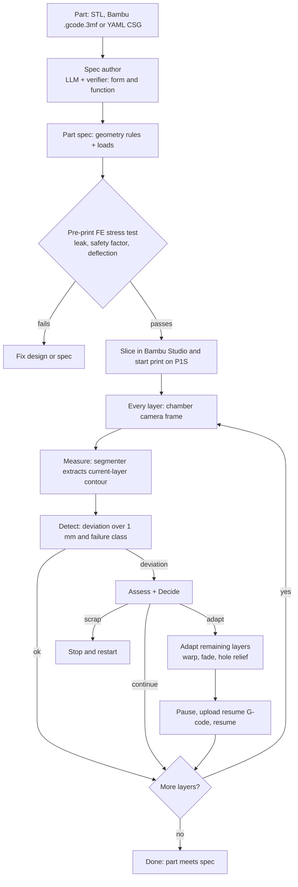
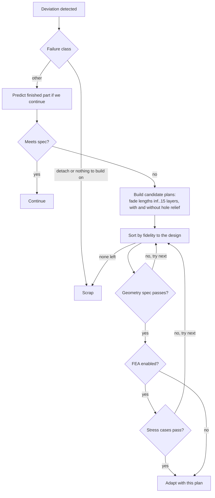

# Functional recovery from 3D-print failures

When a 3D print starts to fail halfway up, you normally have two bad options: throw it away or
keep printing a broken part. This project adds a third: **watch every layer, measure what went
wrong, check whether the part can still do its job, and if so re-plan the remaining layers and
resume automatically.** A mug whose wall sagged into a teardrop becomes a teardrop mug that still
holds water.

It is built for the **Bambu Lab P1S + Bambu Studio** and also runs fully in simulation, so you can
try everything below **without a printer**.

> **Honest status.** The software, simulators and tests run (see [Status](#status)). Recovery on a
> *real* printer has **not** been validated: the stop-and-resume step is the thing to prove on a
> scrap print first. Never leave an experimental print unattended.

**Contents:** [Quick start](#quick-start-no-printer-needed) ·
[Use it on your P1S](#use-it-on-your-bambu-p1s-step-by-step) ·
[Add your own part](#add-your-own-part) · [Stress test](#stress-test-the-part-before-printing) ·
[How it works](#how-it-works) · [Commands](#command-cheat-sheet) · [Troubleshooting](#troubleshooting) ·
[Status](#status) · [Project plan](#project-plan)

---

## What you need

| You need | Why | Required? |
|---|---|---|
| A computer with **Python 3.10 – 3.12** (macOS, Linux or Windows) | runs everything | yes |
| `pip install -r requirements.txt` | installs every Python package (below) | yes |
| **Bambu Studio** ([download](https://bambulab.com/en/download/studio)) | slices your part into the `.gcode.3mf` the loop reads | for a real print |
| A **Bambu Lab P1S** on the same network as your computer | the printer | for a real print |
| A printed **checkerboard** (10 x 7 squares of 10 mm) | calibrates the chamber camera | for a real print |
| An **Anthropic API key** (`ANTHROPIC_API_KEY`) | lets Claude write the part's function spec | optional (a built-in fallback exists) |
| **CalculiX** `ccx` | higher-quality stress solver | optional (a built-in solver exists) |

`pip install -r requirements.txt` installs: numpy, scipy, shapely, opencv, pyyaml, matplotlib,
trimesh (geometry and images); **paho-mqtt** (talks to the P1S); **mujoco** (simulated printers);
torch, timm, transformers (optional trained models); gradio (web UI); anthropic (LLM spec author);
pytest (tests). Bambu Studio and CalculiX are separate programs, installed like any other app.

## Quick start (no printer needed)

**1. Get the code and install**

```bash
git clone https://github.com/3D-Printing-Failure-Detection/failure-detection.git
cd failure-detection
python3 -m venv .venv
source .venv/bin/activate            # Windows: .venv\Scripts\activate
pip install -r requirements.txt
export PYTHONPATH=.                  # Windows PowerShell: $env:PYTHONPATH="."
```

**2. Check the install works** (about 20 seconds; expect `passed`, with 1 skipped if CalculiX is absent)

```bash
python -m pytest tests -q
```

**3. Watch the loop recover a failing print.** This injects a layer shift into a simulated mug,
detects it, decides, and writes the adapted G-code:

```bash
python -m recovery.cli demo --part mug --kind shift --seed 3
```

Open `results/demo/event.png` (what the camera saw, what was expected, what was measured) and
`results/demo/final.gcode` (the adapted G-code). Try `--kind collapse | warp | shift | under_extrusion | detach`
and `--part mug | cup | spacer | bracket`.

**4. Stress-test a part** (does it leak? does it hold its load?):

```bash
python -m recovery.cli stress --part mug
```

**5. Optional: the web interface**

```bash
python -m recovery.cli app           # open the address it prints
```

## Use it on your Bambu P1S, step by step

Do these in order. Steps 1–3 are one-time setup. **Always test on a cheap scrap part first.**

### 1. Prepare the printer

1. On the printer screen: *Settings → WLAN* — connect it to the same network as your computer.
2. *Settings → General → LAN Only Mode* — **turn on** (and **Developer mode** if your firmware
   offers it; recent firmware blocks third-party control without it).
3. Write down three things: the printer's **IP address**, its **serial number**, and the
   **8-character access code** shown on the same screen.
4. Make sure nothing blocks ports **8883** (MQTT), **990** (file upload) and **6000** (camera).

### 2. Slice the part in Bambu Studio

1. Open your model, choose the **P1S** profile.
2. In *Process* settings use: **skirt loops 0**, **brim off**, **no supports**, **arc fitting off**,
   and *Timelapse* = **Traditional** (the head parks at every layer change so the camera sees the part).
3. Slice the plate, then *File → Export → Export plate sliced file* and save `mypart.gcode.3mf` in
   this project's `parts/` folder.

### 3. Describe the part

Create `parts/mypart.yaml`:

```yaml
name: mypart
gcode: mypart.gcode.3mf      # the file you just exported: the loop reads the real layers from it
description: "a bracket holding a 2 kg shelf on two M5 bolts"
```

Then let the software write the function spec (what "still works" means) for you:

```bash
export ANTHROPIC_API_KEY=sk-ant-...        # optional; without it a built-in fallback is used
python -m recovery.cli specgen --part parts/mypart.yaml --describe "a bracket holding a 2 kg shelf on two M5 bolts"
```

Read the printed rationale and the file it wrote in `parts/specs/`. **Check the numbers
(loads, tolerances) yourself**: the AI proposes, you approve. Add `spec_file: specs/mypart.yaml` to
`parts/mypart.yaml`. More ways to write specs: [Add your own part](#add-your-own-part).

### 4. Calibrate the chamber camera (once)

The P1S camera looks at the bed from an angle; calibration lets the software turn that into a
top-down view. Print or display a **10 x 7 square checkerboard, 10 mm squares**. Then:

```bash
python -m recovery.cli calibrate --ip 192.168.1.50 --code 12345678 --calib-z 10 --out calib.npz
```

It asks you to hold the board at 12 different positions/tilts, pressing Enter each time, and then
to lay it **flat on the bed** with its first inner corner at the bed position you passed in
`--board-origin` (default X=100 Y=100 mm). Replace the IP and access code with yours. This writes
`calib.npz`; keep it, it only needs redoing if the camera moves.

**The bed moves, so tell it where the bed was.** The P1S bed drops one layer per layer while the
camera stays fixed, so the top of the print stays near the nozzle height. Before the flat shot, home
the printer and move the bed to a known Z from the screen (e.g. 10 mm), and pass that as `--calib-z`
(add `--board-thickness` if the board is on card or foam). The calibration stores it and maps every frame on the
plane `calib-z` above the calibrated plate (lowered by however far the bed has dropped when each frame is
grabbed). It also prints the camera's fitted position and angle and refuses to save (unless `--force`) if its
height above the print plane is more than 1 mm off the measured 22.784 mm
(`P1S_CAMERA_ABOVE_PRINT_PLANE_MM` in `recovery/config.py`); that only catches gross mistakes, since 1 mm of
height is about 8 mm on the bed. Calibration files without `--calib-z` are refused by `watch`, `live` and `agent`.

Have a large board (e.g. one covering the plate)? `python -m recovery.cli calibrate-board` uses raw frames of
it held at different angles plus flat frames at two bed heights, and falls back to the flat frames alone. It
checks that the camera height changes by the bed's Z change. Guide: [docs/calibration-board.md](docs/calibration-board.md).

No checkerboard? `python -m recovery.cli calibrate-bed` fits the camera from the plate itself
(about 0.5 mm in simulation; unproven on a real printer, so the board is still the reference):

```bash
# 1. grab a frame and write calib_click.html
python -m recovery.cli calibrate-bed --ip 192.168.1.50 --code 12345678 --out calib.npz
# 2. open calib_click.html, click 8+ points along each plate edge, and 5-9 "markers" (tape dots at
#    measured X,Y mm from the front-left corner), Copy JSON -> points.json
# 3. fit; it prints residuals and refuses to save a calibration it cannot vouch for
python -m recovery.cli calibrate-bed --ip 192.168.1.50 --code 12345678 --points points.json --calib-z 10 --out calib.npz
```

Then check `calib_overlay.png` (the green outline must sit on the plate edges) and run `watch` on a clean
print. If the camera sees the plate at a grazing angle, markers are what make it work. Full guide:
[docs/calibration-without-checkerboard.md](docs/calibration-without-checkerboard.md).

### 5. Stress-test before you print

```bash
python -m recovery.cli stress --part parts/mypart.yaml
```

If it says `FAIL`, fix the design (or the spec) before wasting filament. The live command below
repeats this check and refuses to start on a failing part.

### 5b. First runs: check, probe, then watch only (do this before step 6)

None of these send a print command, so they are safe on any print. Steps 3 and 5 are not needed.

```bash
# offline: does our parser understand your Bambu Studio export? (markers, layer count, outlines)
python -m recovery.cli check-gcode parts/mypart.gcode.3mf
# read-only: printer status over MQTT + one camera frame saved to results/probe/
python -m recovery.cli probe --ip 192.168.1.50 --serial 01P00A000000000 --code 12345678
# start the print as usual, then watch it: measures every layer, logs what it WOULD do
python -m recovery.cli watch --gcode parts/mypart.gcode.3mf \
    --ip 192.168.1.50 --serial 01P00A000000000 --code 12345678 --calib calib.npz
```

- `check-gcode` should end with `looks usable` and its preview PNG should show real holes only.
  If it reports 0 layers or a layer count that differs from the slicer's, stop and send the
  output to the team: `live` would match frames to the wrong layers.
- `watch` writes `results/watch/<time>/`: `layers.jsonl` (one line per layer: label, deviation,
  and on an alarm `would_action`/`would_reason`), `meta.json`, and `frames/` (raw camera frame,
  top-down view and expected mask per layer). These are our first real images; keep them.
  Ctrl-C stops watching without affecting the print. A long print can run inside `tmux`.
- No checkerboard yet? Run `watch` without a `calib.npz`: it then saves only the raw frames
  and layer timing (label `unmeasured`), which is still useful real data.
- On a clean print every layer should be `ok`. Alarms on a clean print are false alarms:
  tune thresholds and calibration before letting `live` act.

### 6. Print with the safety net on

Only after `watch` runs on clean prints show no false alarms.

1. Start the print from Bambu Studio or the printer screen as usual.
2. In another terminal, start the loop (use your own IP, serial and code):

```bash
python -m recovery.cli live --part parts/mypart.yaml \
    --ip 192.168.1.50 --serial 01P00A000000000 --code 12345678 --calib calib.npz \
    --rehome-gcode lift_xy
```

The loop now checks every finished layer. If a layer is off by more than 1 mm it decides:
**continue**, **adapt**, or **scrap**. To adapt it stops the print, uploads a new G-code file for
the remaining layers, and starts it, all automatically, then re-syncs its layer counter.

**What to watch for.** After a stop, the printer must still know where its head is. If the first
resumed layer lands in the wrong place, stop the print, and see [Troubleshooting](#troubleshooting).
`--rehome-gcode lift_xy` lifts the head clear of the part and re-homes X/Y only (never Z, which
would crash the nozzle into the part). Use `--skip-stress` only if you accept an unchecked part.

## Add your own part

A part is one small YAML file: geometry plus a function spec. Pick any one geometry source:

```yaml
name: mypart
gcode: mypart.gcode.3mf          # (a) a Bambu Studio sliced file  -- best for real prints
# stl: models/mypart.stl         # (b) a mesh, sliced internally   -- good for simulation
# geometry:                      # (c) simple shapes written directly
#   - add: {circle: {center: [0, 0], r: 30}}
#   - cut: {circle: {center: [0, 0], r: 27}}
```

The **function spec** says what the part must still do after a failure: no thinner wall than X,
holds liquid, bolt holes stay put, the handle stays attached, survives a load. Three ways to get one:

| How | Command | When |
|---|---|---|
| **Claude writes it (default)** | `python -m recovery.cli specgen --part P --describe "what it is for"` | a new part; always review the result |
| A ready-made template | `... specgen --part P --method template --template container` (also `compression`, `cantilever`; tweak with `--param force_N=80`) | a standard kind of part |
| Offline rules | `... specgen --part P --method heuristic` | no API key, or a quick baseline |
| By hand | write the keys in the YAML (see `parts/_template.yaml.txt`) and check with `--method manual --manual spec.yaml` | you know exactly what you need |

Whatever the method, the result is **verified against the nominal part** (it must pass on the
design as drawn) before it is accepted. Add `--strict` to make the Claude method fail loudly
instead of silently using the offline fallback.

## Stress-test the part before printing

`stress` runs a finite-element simulation of the sliced part: liquid pressure with a leak test,
forces on chosen faces, fixed supports, and the weaker bond between layers.

```bash
python -m recovery.cli stress --part mug                     # all load cases in the spec
python -m recovery.cli stress --part bracket --failure shift # what if a shift happens? (what-if)
python -m recovery.cli stress --part mug --converge          # is the answer mesh-independent?
python -m recovery.cli fea-verify                            # check the solver against textbook results
```

It prints a safety factor per load case (**1.5 or more passes by default**) and saves stress maps
to `results/stress/`. The solver is **CalculiX** if installed (recommended), otherwise a built-in one.

Install CalculiX (optional): `sudo apt install calculix-ccx` · `conda install -c conda-forge calculix`
· macOS: use conda or build from [calculix.de](https://www.calculix.de) (Homebrew formula names vary).
Then `python -m recovery.cli stress --part mug --solver calculix`.

> **Limits.** CalculiX is open source and widely used but **not certified**, and the voxel mesh is
> coarse. Treat results as a screening tool, not a safety guarantee. The material numbers
> (`recovery/fea/material.py`) are generic PLA/PETG/ABS values: print a few tensile bars on your
> P1S and edit them for quantitative work, and physically test anything that carries a real load.

## How it works

A print is a stack of ~0.2 mm slabs. If slab *k* lands somewhere other than planned (wall sags,
the part slips on the bed, a section is starved of plastic) every slab above it inherits the
error. Scrapping wastes hours; ignoring it can ruin the function (a mug that leaks, a spacer whose
bolt holes moved). The loop looks at the newest slab, measures how far it is from plan, asks
"can this part still do its job?", and if so **re-plans the slabs not yet printed** to start from
what is really there (a circular mug becomes a teardrop mug that still holds water).

### Flowcharts

#### End to end



#### Decision on a detected deviation



### The AI spec author

Usage is in [Add your own part](#add-your-own-part). Methods: `--method llm` (default) | `heuristic` | `template` (`--template container|compression|cantilever
--param force_N=80`) | `manual` (`--manual spec.yaml`, verified only). `--strict` makes the LLM
method fail instead of silently falling back to the heuristic.

The model sees a geometry summary (layer areas, wall thickness, holes, components per z-range)
and the description, and returns the spec: form rules and the physical load cases. A verifier
then checks the spec against the nominal part (geometry rules and a stress test) and feeds
violations back for up to 3 rounds, so an over-strict or inconsistent spec is repaired before it
is accepted. Output goes to `parts/specs/<name>.yaml`; reference it with `spec_file:`. The LLM
never decides pass/fail at run time; the same deterministic checks do.

### The stress simulator (`recovery/fea/`)

A real (small) finite-element solver for the part about to be printed:

- The sliced layers are voxelised into hex8 bricks with a **transversely isotropic** FDM
  material (PLA, PETG, ABS), weak across layers.
- Loads come from the spec: hydrostatic liquid pressure on walls and floor (with a flood-fill
  leak test through any gap), point/face forces on selected regions, fixed supports.
  Pieces not connected to a support are reported as broken off.
- Matrix-free Jacobi-preconditioned CG solves for displacement. Output: safety factor from the
  99th-percentile element's failure index (von Mises in-plane, interlayer tension and shear),
  max deflection, leak, capacity, with a stress-map figure.
- It is used three ways: **pre-print gate** (`live` refuses a part that fails unless
  `--skip-stress`), **candidate filter** while adapting (`use_fea`), and **what-if** on injected
  failures.

Usage is in [Stress-test the part before printing](#stress-test-the-part-before-printing).


#### Solver choice and verification

`stress --solver auto|calculix|builtin` (default `auto`: CalculiX if `ccx` is on PATH or
`$CCX_PATH`, else built-in). The same voxel mesh, orthotropic FDM material, supports and loads go
to either solver (`recovery/fea/calculix.py` writes a C3D8 input deck and reads back
displacements and integration-point stresses). Install CalculiX with `apt install calculix-ccx`
or `conda install -c conda-forge calculix`.

CalculiX is open source and widely cross-checked, **not certified** by any standards body. What
the code gives you instead is evidence you can reproduce:

```bash
python -m recovery.cli fea-verify --solver calculix    # closed-form tension + cantilever
python -m recovery.cli stress --part mug --converge    # safety factor vs mesh size
```

For quantitative claims you still need real material numbers (print tensile coupons flat and
upright and edit `fea/material.py`) and a physical test of the finished part.

### Perception models (video-style, no TorchVision)

Both nets see a short temporal stack: previous frame, current frame, expected render (7
channels), so they see what changed between layers. Train on synthetic data, fine-tune on real:

```bash
python -m recovery.cli gen-data --n 4000 --out data/synth.npz
python -m recovery.cli train --data data/synth.npz --epochs 15 --pretrained
python -m recovery.cli train --data data/synth.npz --init runs --real data/real.npz --epochs 8 --lr-det 1e-4 --lr-seg 3e-5
```

Classical (threshold) versions are the default and need no training. SAM 2 video tracking is a
possible next step, not wired in.

### How the plan maps to code

| Plan stage | Code |
|---|---|
| Slicer to expected layers | `gcode.py`, `parts.py`, `slicing.py` |
| Synthetic failures and renders | `deform.py`, `camera.py`, `models/synth_data.py` |
| 1. Detect | `models/classical.py`, `models/nets.py` (ConvNeXt-V2) |
| 2. Measure | `models/classical.py`, `models/nets.py` (SegFormer) |
| 3. Assess | `geometry/spec.py`, `fea/` |
| 4. Decide | `loop/decide.py` (rules), `loop/llm.py` (LLM picks among spec-passing options) |
| 5. Adapt | `geometry/adapt.py` |
| 6. Interface | `app.py`, `printer/bambu.py`, `sim.py` |
| Evaluation | `eval/run_eval.py` (ignore, scrap, alert, ours) |

## Command cheat sheet

| Command | What it does |
|---|---|
| `demo --part P --kind K` | simulate one failure and the recovery |
| `eval --n 8` / `mujoco-eval --n 2` | compare ignore / scrap / alert / recover over many simulated failures |
| `specgen --part P` | write the function spec (Claude by default) |
| `stress --part P` | FE stress test, optionally with an injected failure |
| `fea-verify` | check the stress solver against closed-form answers |
| `slice file.stl` | cross-section an STL |
| `calibrate --ip ... --code ... --calib-z 10` | calibrate the P1S camera (bed at Z=10 mm for the flat shot) |
| `live --part P --ip ... --serial ... --code ... --calib calib.npz` | run the loop on a real print |
| `app` | web interface |
| `gen-data`, `train` | make synthetic images and train the optional neural models |

Run any command with `-h` for all options. Simulation experiments and results are described in
[docs/experiments-overview.md](docs/experiments-overview.md) and [docs/mujoco-report.md](docs/mujoco-report.md).

## Troubleshooting

| Symptom | Fix |
|---|---|
| `ModuleNotFoundError: recovery` | run from the project folder and `export PYTHONPATH=.` |
| `No module named ...` | activate the venv (`source .venv/bin/activate`) and re-run `pip install -r requirements.txt` |
| MuJoCo error about `MUJOCO_GL` (Linux server) | `export MUJOCO_GL=egl`; on a desktop leave it unset |
| `calibrate`/`live` cannot connect | check LAN Only Mode, IP, access code, same network, ports 8883/990/6000 |
| No camera frames | the P1S camera only streams in LAN mode; make sure only one program is using it |
| Loop says "printer did not acknowledge stop/pause" | the printer is busy or the firmware blocks control: enable Developer mode, retry |
| First resumed layer is shifted | the head lost its position after STOP. Re-run with `--rehome-gcode lift_xy`, or supply your own safe re-home G-code; test with a scrap print |
| `stress` says `solver: builtin` | CalculiX not found; install it or set `CCX_PATH=/path/to/ccx` |
| `specgen` says `source: heuristic` | no `ANTHROPIC_API_KEY` or the reply could not be used; the offline fallback was used |
| A part is rejected as outside the camera view | the camera covers 128 mm x 128 mm; keep parts smaller or edit `recovery/config.py` |

## Status

What has actually been run:

- **Tests:** `python -m pytest tests -q` passes (285 passed, 1 skipped when CalculiX is absent) on
  macOS with a fresh virtual environment built from `requirements.txt`.
- **Stress solver:** the built-in solver matches closed-form tension and cantilever results to about
  1% (`fea-verify`). The CalculiX path is written and unit-tested to match the built-in one but
  needs `ccx` installed to run.
- **Simulation:** the full loop runs on three simulated printers (MuJoCo). In the team's paired
  tests recovery did **not** yet beat simply ignoring the failure; see
  [docs/mujoco-report.md](docs/mujoco-report.md).
- **Not validated:** anything on a physical P1S (MQTT, upload, camera, stop-and-resume), live LLM
  spec writing, and full neural-model training accuracy.

## Modelling assumptions to state in the report

- The simulator is a surrogate. Failures grow progressively (collapse over ~3 mm, shift over a
  few layers); once the controller adapts, the cause is assumed transient and later layers
  deposit as commanded (± 0.06 mm noise). Ignoring a failure lets it persist.
- "Functional" is the spec check in `geometry/spec.py` (including an excess-overhang rule), not a
  physical test. Validate with real prints (e.g. fill the mug with water).
- Abrupt shifts and gaps through already-printed walls are unrecoverable by design → scrap.
- Detection threshold is 1.0 mm; smaller deviations are treated as benign.
- The legacy `eval` command assumes a clean restart succeeds. The new `mujoco-eval`
  reports a scrap as a scrap; a restart is only a separately named cost assumption.

## Project plan

The input document for this work, reproduced in full (PDF: [docs/project-plan.pdf](docs/project-plan.pdf)).


### Problem and goal
When a print fails mid-way, today's options are to scrap it or keep printing a defective part. Both waste hours and filament. Our goal is a feedback loop that catches the failure during the print and adapts the rest of the print so the part still works, even if it looks different.

Example from class: a mug's wall deforms so its circular cross-section becomes a teardrop. Instead of scrapping it, the system continues as a teardrop mug that still holds liquid and keeps its handle. Function is preserved; aesthetics change.

### The feedback loop
Every layer is imaged and checked. On a deviation, the system measures the as-printed shape, checks the part's function spec, and either continues, adapts the remaining layers, or scraps.

### Scope for 4 weeks
The 4-week version targets simple parts where function can be checked from cross-sections, and deformations that leave a usable base to build on.

| | In scope | Out of scope |
|---|---|---|
| Parts | 2.5D parts whose function is set by cross-sections: cups and mugs, containers, brackets, spacers | Complex organic shapes, multi-material, supports-heavy parts |
| Failures | Wall deformation, warping, partial layer shift, under-extrusion of a section | Spaghetti or a detached part (nothing to build on), so these go to scrap |
| Function | A short spec per part, e.g. holds liquid (closed walls, flat base), volume within a tolerance, minimum wall thickness, handle attached | Strength or load testing beyond simple checks |
| Printer | Pause, adapt remaining G-code, resume on one printer we have access to | Fully hands-off physical removal or ejection |

### Components and models
The trained models cover detection and measurement; adaptation is geometry code with an LLM or rules choosing the strategy.

| Stage | What it does | How |
|---|---|---|
| 1. Detect | Flag that a layer deviates and classify the failure type | Fine-tuned image classifier or detector on layer images (trained model) |
| 2. Measure | Extract the as-printed contour of the current layer and compare it to the expected contour from the G-code | Fine-tuned segmentation model on top-down images, registered to the rendered expected layer (trained model) |
| 3. Assess | Check whether the part can still meet its function spec | Rule checks on the measured shape: closed walls, wall thickness, volume estimate |
| 4. Decide | Continue, adapt or scrap | Policy over severity, functional slack, time and filament left; rules first, LLM planner as an option |
| 5. Adapt | Re-plan the remaining layers to start from the deformed contour and still meet the spec (circle becomes teardrop) | Morph remaining cross-sections from the measured contour, re-slice from the current height, resume |
| 6. Interface | Show the deviation, the decision and a preview of the adapted part | Gradio app; printer control through Klipper/Moonraker or OctoPrint |

### Data
Most training data will be synthetic, because printer time is limited; real prints are for validation.

| Source | What it gives | Size and caveats |
|---|---|---|
| Synthetic layers | Expected layer renders from sliced G-code with injected deformations (warp, shift, wall collapse); exact ground-truth contours | Unlimited; PrusaSlicer runs headless at under 0.5 s per slice. Gap to real camera images |
| Slice-100K | 100k models with G-code to slice and deform | Download location to confirm |
| CAXTON (Cambridge, 2022) | 1.2M real print images from 192 parts, labelled with process parameters | Labels are parameters, not geometry; public availability to confirm |
| Public failure images (Roboflow, Hugging Face) | Labelled failure types for the detector | Small (the Hugging Face set has 73 images); mixed licences |
| Our prints | Real layer images with deliberately induced failures, plus end-to-end demos | Roughly 5-10 prints given printer time |

### Evaluation
The main question: when a failure happens, how often does the loop end with a part that still meets its function spec, compared with scrapping or ignoring it?

- Detection and measurement: classification accuracy and false alarms; contour error (IoU, mm deviation) on held-out synthetic and real layers.
- Recovery in simulation: inject failures at random heights in sliced test parts, run the loop, and check the final geometry against the spec. Report the share of functional parts plus filament and time saved.
- Baselines: (a) ignore the failure and keep printing, (b) scrap and restart, (c) pause and alert a human.
- Physical validation: a few real prints with an induced failure, resumed with adapted G-code; check function directly (e.g. fill the mug with water).

### Week-by-week plan
1. **Week 1: problem and pipeline.** Interview a few makerspace or print-farm users about failures. Pick 3-5 test parts and write their function specs. Build the slicer-to-render-to-deform pipeline. Mount the camera and test pause, edit and resume on the printer with one manual example.
2. **Week 2: models.** Generate synthetic data; fine-tune the detector and the contour segmentation model. Collect the first real layer images with induced failures.
3. **Week 3: the loop.** Implement assess, decide and adapt (contour morphing and re-slicing from the current height). Run the loop end to end in simulation; first physical adapted print.
4. **Week 4: evaluate and ship.** Baseline comparisons, real-print validation, Gradio app, report and presentation.

Concept generation and selection for the product-development write-up (scrap-and-requeue agent vs. functional adaptation vs. alert-only) runs alongside week 1.

### Prior work and what's new
Existing closed-loop systems correct process parameters, not geometry. Changing the remaining design mid-print to keep the part functional appears to be open.

| Work | What it corrects | Gap for us |
|---|---|---|
| CAXTON (Cambridge, 2022) | Flow rate, speed, temperatures, Z offset, in real time | Parameters only; no geometry change |
| LLM-3D Print (2024) | GPT-4o agents read layer images and adjust parameters via Klipper | Never alters G-code geometry; layer shifts excluded as unfixable |
| Task-driven printability assistance (2026) | LLM + knowledge graph recommends design and material changes for a stated task | Before printing only; recommends, doesn't modify |
| Manual resume of a failed print | A maker trimmed the G-code and resumed by hand | Shows physical resume is possible but fiddly; layer bonding failed |

Our contribution: detect and measure the deformation, then adapt the remaining geometry to a function spec and resume.

### Risks and open questions

| Risk | Mitigation |
|---|---|
| Resuming on a deformed part may bond poorly or collide with it | Pause, adapt and resume without removing the part; first layers of the new plan start from the measured contour; test early in week 1 |
| Synthetic images differ from real camera views | Use synthetic for pretraining, fine-tune on our real layer images, report real-image results separately |
| Top-down camera may not measure the contour precisely enough | Fixed camera mount and calibration target; compare against a caliper measurement on a few prints |
| Function specs are part-specific | Limit to 3-5 parts with written specs; frame specs as a reusable template |
| Very few real prints | Evaluate mostly in simulation; physical prints as validation and demo |

Open questions:
- Which printer do we have, and can it run Klipper/OctoPrint with a camera?
- Is CAXTON's image dataset publicly downloadable?
- Should the loop also include the scrap-and-requeue agent idea as the "scrap" branch?

### Sources
- Generalisable 3D printing error detection and correction via multi-head neural networks (CAXTON), Nature Communications 2022
- Matta: Detecting and correcting 3D printing errors on the fly
- LLM-3D Print: Large Language Models To Monitor and Control 3D Printing
- Task-Driven 3D Printability Assistance via Geometry- and Knowledge-Grounded LLM Reasoning
- Fabbaloo: Maker experiments with manually resuming a failed 3D print
- Slice-100K: A Multimodal Dataset for Extrusion-based 3D Printing
- Roboflow: 3D print fail detection dataset
- Hugging Face: failures-3D-print dataset
