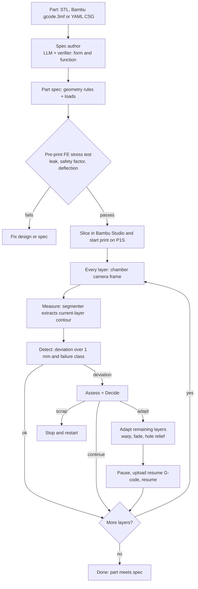
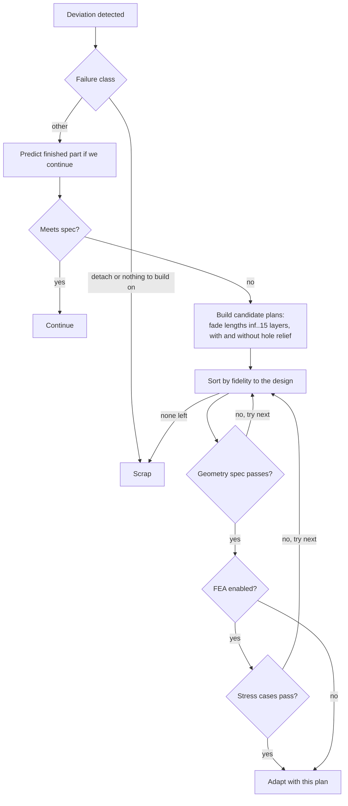

# Functional recovery from 3D-print failures

A feedback loop that **stress-tests a part before printing, images every layer while printing,
and when something goes wrong measures the as-printed shape and decides to continue, adapt the
remaining layers, or scrap**, so the finished part still does its job even if it looks different.
Target hardware: **Bambu Lab P1S + Bambu Studio**. Based on the [Project 2 plan](#project-plan)
(also in [docs/project-plan.pdf](docs/project-plan.pdf)).

> **Status: research prototype.** The classical loop now runs against three MuJoCo
> printer rigs, with paired failure evaluations and regression tests. See the
> [review and generalization report](docs/mujoco-report.md) for measured results,
> corrected errors, reproduction commands, and simulation limits. Trained-model
> development results are recorded separately below. Real-printer recovery remains
> unvalidated.

The repository-root [project report (PDF)](report.pdf) explains the system,
current implementation, experimental results, limitations, and next steps.
Its source is `docs/report.tex`; rebuild it with `python3 tools/build_report.py`.

## MuJoCo across printer configurations

The optional backend executes extrusion waypoints on Cartesian, ideal CoreXY,
and moving-bed rigs. The same perception and policy consume calibrated MuJoCo RGB
images on all three. These are illustrative configurations, not calibrated models
of commercial machines. Deposition and failure evolution remain explicit geometric
surrogates; this does not simulate molten plastic or adhesion.

```bash
python3 -m venv .venv
.venv/bin/pip install -r requirements-sim.txt
MUJOCO_GL=egl OPENBLAS_NUM_THREADS=1 OMP_NUM_THREADS=1 \
  .venv/bin/python -m recovery.cli mujoco-eval --n 2 --seed 10 --workers 6 \
  --out results/mujoco-persistent
```

This images every monitored layer, includes clean controls and all four policies,
and leaves injected failures active after adaptation. Use a fresh output directory
for each run. The optimistic assumption in the older simulator can be measured
separately with `--clear-failure-on-adapt --methods ours`. Results report observed
in-place success separately from a hypothetical restart's filament cost. Raw runs,
summary tables, environment metadata, and a source digest are saved together.

On this machine, the environment and raw experiment outputs live under
`/mnt/data/ishaan/hri-workspace/failure-detection`; `.venv` is a local symlink.
On another machine, choose an appropriate disk for environments and results.

The [follow-up policy trial](docs/functional-policy-trial.md) tests three cumulative
changes: `measured` retains every measured layer and adds functional alarms;
`predictive` also forecasts persistent deposition error and compensates commands;
`functional` also ranks feasible plans by functional margin under geometric
uncertainty. These are experimental options; `ours` remains the default. Compare
them with `--methods ignore ours measured predictive functional`. The CLI demo
also accepts `--policy functional`, but its older simulator clears failures after
adaptation; use MuJoCo without `--clear-failure-on-adapt` to test persistence.

The [notebook-inspired constrained policy](docs/notebook-recovery-trial.md),
available as `guarded`, separates function, executable recovery and intervention
cost. It retains a passing continuation, checks the remaining replan budget and
printer bounds, and builds corrections using an explicit per-layer assumption.
Compare it with `--methods ignore ours predictive functional guarded`. The
notebook's success probability remains an unknown input; a geometry margin is
not used as a probability. This policy also remains opt-in.

The [contour prediction trial](docs/contour-prediction-trial.md) adds the opt-in
`contour` policy. It matches inner and outer wall boundaries separately when
forecasting deposition and computing compensation, while retaining the guarded
policy's functional checks and action limits. Compare with
`--methods ignore ours guarded contour`; the demo also accepts `--policy contour`.
Use the persistent-failure MuJoCo evaluation for recovery evidence.

The [learned recovery experiment](docs/neural-recovery-plan.md) trains a temporal
neural network and runs a free local Qwen model in the decision loop, without an
API key. Its optional `neural_risk` and `neural_risk_agent` policies can intervene
before a tight fit becomes unusable. Selected development cases improved, but
overall superiority is still being evaluated; these policies remain opt-in.
The experiment records real model calls, failed attempts and neural-only
ablations. It does not count an agent response or lower prediction error as a
successful print.

## The idea in physical terms

A print is a stack of ~0.2 mm slabs. If slab *k* lands somewhere other than planned (wall sags,
the part slips on the bed, a section is starved of plastic) every slab above it inherits the
error. Scrapping wastes hours; ignoring it can ruin the function (a mug that leaks, a spacer whose
bolt holes moved). The loop looks at the newest slab, measures how far it is from plan, asks
"can this part still do its job?", and if so **re-plans the slabs not yet printed** to start from
what is really there (a circular mug becomes a teardrop mug that still holds water).

## Flowchart

### End to end



### Decision on a detected deviation



## Software

| Need | Software |
|---|---|
| Language | Python 3.12 |
| Geometry | `shapely` 2.x, `numpy`, `scipy` |
| Images | `opencv-python-headless` (render, contours, camera homography) |
| Detector | **ConvNeXt-V2** via `timm` (replaces the old TorchVision ResNet) |
| Segmenter | **SegFormer / MiT** via `transformers` (replaces the old U-Net) |
| Stress simulator | built-in voxel FEA (`recovery/fea/`), `numpy` + `scipy` |
| Spec author | `anthropic` SDK (Claude, `claude-sonnet-5-5`), `ANTHROPIC_API_KEY`; heuristic fallback without it |
| Slicer | **Bambu Studio** (`.gcode.3mf`); built-in 2.5D slicer + `trimesh` for STL experiments |
| Printer | **Bambu Lab P1S**, LAN mode: MQTT (`paho-mqtt`), FTPS 990, camera port 6000 |
| Interface / eval | `gradio`, `matplotlib`, `pytest` |

```bash
python3.12 -m venv .venv && .venv/bin/pip install -r requirements.txt
export PYTHONPATH=.
```

## Generic by construction

Nothing in the pipeline knows about mugs. A part is data: geometry plus a spec.

- **Geometry:** a YAML stack of `add`/`cut` shapes (circle, rect, polygon, tapers), an `stl:`
  mesh, or a Bambu Studio `gcode:` file.
- **Spec rules:** `container`, `min_wall_mm`, `material_volume_mm3`, `holes`, `connected`,
  `present` (all optional) plus `material`, `loads` and `description`.
- `parts/*.yaml` (mug, cup, spacer, bracket) are only examples. Start from
  `parts/_template.yaml.txt`.

### LLM spec author (pins form and function)

```bash
.venv/bin/python -m recovery.cli specgen --part parts/mypart.yaml \
    --describe "bracket holding a 2 kg shelf on two M5 bolts"   # add --no-llm for heuristics only
```

The model sees a geometry summary (layer areas, wall thickness, holes, components per z-range)
and the description, and returns the spec: form rules and the physical load cases. A verifier
then checks the spec against the nominal part (geometry rules and a stress test) and feeds
violations back for up to 3 rounds, so an over-strict or inconsistent spec is repaired before it
is accepted. Output goes to `parts/specs/<name>.yaml`; reference it with `spec_file:`. The LLM
never decides pass/fail at run time; the same deterministic checks do.

## Stress-testing simulator (`recovery/fea/`)

A real (small) finite-element solver for the part about to be printed:

- The sliced layers are voxelised into hex8 bricks with a **transversely isotropic** FDM
  material (PLA, PETG, ABS), weak across layers.
- Loads come from the spec: hydrostatic liquid pressure on walls and floor (with a flood-fill
  leak test through any gap), point/face forces on selected regions, fixed supports.
  Pieces not connected to a support are reported as broken off.
- Matrix-free Jacobi-preconditioned CG solves for displacement. Output: safety factor from the
  99th-percentile element's failure index (von Mises in-plane, interlayer tension and shear),
  max deflection, leak, capacity, with a stress-map figure.
- It is used three ways: **pre-print gate** (`live` refuses a part that fails unless
  `--skip-stress`), **candidate filter** while adapting (`use_fea`), and **what-if** on injected
  failures.

```bash
.venv/bin/python -m recovery.cli stress --part mug --h 1.0
.venv/bin/python -m recovery.cli stress --part bracket --failure shift --severity 3 --seed 1
```

This is linear elasticity at coarse resolution, a screening tool, not certification.

## Perception models (video-style, no TorchVision)

Both nets see a short temporal stack: previous frame, current frame, expected render (7
channels), so they see what changed between layers. Train on synthetic data, fine-tune on real:

```bash
.venv/bin/python -m recovery.cli gen-data --n 4000 --out data/synth.npz
.venv/bin/python -m recovery.cli train --data data/synth.npz --epochs 15 --pretrained
.venv/bin/python -m recovery.cli train --data data/synth.npz --init runs --real data/real.npz --epochs 8 --lr-det 1e-4 --lr-seg 3e-5
```

Classical (threshold) versions are the default and need no training. SAM 2 video tracking is a
possible next step, not wired in.

## How the plan maps to code

| Plan stage | Code |
|---|---|
| Slicer to expected layers | `gcode.py`, `parts.py`, `slicing.py` |
| Synthetic failures and renders | `deform.py`, `camera.py`, `models/synth_data.py` |
| 1. Detect | `models/classical.py`, `models/nets.py` (ConvNeXt-V2) |
| 2. Measure | `models/classical.py`, `models/nets.py` (SegFormer) |
| 3. Assess | `geometry/spec.py`, `fea/` |
| 4. Decide | `loop/decide.py` (rules), `loop/llm.py` (LLM picks among spec-passing options) |
| 5. Adapt | `geometry/adapt.py` |
| 6. Interface | `app.py`, `printer/bambu.py`, `sim.py` |
| Evaluation | `eval/run_eval.py` (ignore, scrap, alert, ours) |

## Run

```bash
.venv/bin/python -m recovery.cli demo --part mug --kind collapse --seed 3
.venv/bin/python -m recovery.cli eval --n 8
.venv/bin/python -m recovery.cli app
.venv/bin/python -m pytest tests
```

## Bambu Studio + P1S setup (week 1, untested on hardware)

**Slice in Bambu Studio** (P1S profile). Process settings that keep the parsed layers clean:
skirt loops 0, brim off, no supports, "Arc fitting" off, timelapse **traditional** (the head
parks at each layer change, giving the camera a clear view). Right-click the plate →
*Export plate sliced file* → `part.gcode.3mf`. Headless alternative: `slicing.bambu_studio_slice`.
Point the part YAML at it:

```yaml
name: mypart
gcode: mypart.gcode.3mf        # nominal layers = exactly what the printer will print
min_wall_mm: 1.6               # ...plus the function spec (see "Adding your own part")
```

**Printer:** enable LAN mode (and Developer mode if your firmware offers it; recent firmware
restricts third-party control without it). Note the IP, serial number and 8-digit access code.
Ports needed: 8883 (MQTT), 990 (FTPS), 6000 (camera).

**Camera:** the P1S chamber camera looks at the bed at an angle, not top-down. Print a
checkerboard at 100% scale, then run `calibrate` (12 shots at different tilts + one flat on the
bed at a known position). The pose-based `BedCamera.top_down` re-projects each frame onto the
plane at the current layer height, so it needs no overhead camera. For best accuracy fix a
dedicated overhead webcam later; the models only see the re-projected view either way.

```bash
.venv/bin/python -m recovery.cli calibrate --ip 192.168.1.50 --code 12345678 --out calib.npz
# start the print from Bambu Studio / the printer screen, then:
.venv/bin/python -m recovery.cli live --part parts/mypart.yaml --ip 192.168.1.50 \
    --serial 01P00A000000000 --code 12345678 --calib calib.npz
```

**The risky part — changing the remaining layers.** A running Bambu job cannot be edited. The
adapter (`BambuPrinter.replace_remaining`) pauses, stops, uploads a self-contained resume G-code
(heat, no homing, adapted layers, `M73 L<n>` so `layer_num` keeps counting) over FTPS and starts it
with `gcode_file`. That works only if the P1S still knows its position after STOP; if it does not,
pass `--rehome-gcode` (re-home XY and re-reference Z at a bed corner away from the part; never
`G28` over the part). Streaming mode is rejected because it has no execution acknowledgements.
Pause, stop, and replacement-start timeouts now abort instead of silently proceeding.
**Validate restart behavior on a scrap print first**: this is the hinge of the
project (the plan's week-1 "pause, edit, resume" test).

## Status: what has and hasn't been verified

The [dated report](docs/mujoco-report.md) and [validation records](docs/validation/)
supersede the original branch's unexecuted-test claims. Validation includes the
classical loop, all four part specifications, G-code parsing, actual MuJoCo camera
and motion tests, an analytical FEA patch test, nominal structural loads, offline
spec generation, STL cross-section smoke testing, and saved SegFormer architecture
reload/inference. Full learned-model training and accuracy, live LLM calls, the
Gradio UI, Bambu Studio CLI, and physical MQTT/FTPS/camera/resume behavior remain
outside those results.

## Modelling assumptions to state in the report

- The simulator is a surrogate. Failures grow progressively (collapse over ~3 mm, shift over a
  few layers); once the controller adapts, the cause is assumed transient and later layers
  deposit as commanded (± 0.06 mm noise). Ignoring a failure lets it persist.
- "Functional" is the spec check in `geometry/spec.py` (including an excess-overhang rule), not a
  physical test. Validate with real prints (e.g. fill the mug with water).
- Abrupt shifts and gaps through already-printed walls are unrecoverable by design → scrap.
- Detection threshold is 1.0 mm; smaller deviations are treated as benign.
- The legacy `eval` command assumes a clean restart succeeds. The new `mujoco-eval`
  reports a scrap as a scrap; a restart is only a separately named cost assumption.

## Project plan

The input document for this work, reproduced in full (PDF: [docs/project-plan.pdf](docs/project-plan.pdf)).


### Problem and goal
When a print fails mid-way, today's options are to scrap it or keep printing a defective part. Both waste hours and filament. Our goal is a feedback loop that catches the failure during the print and adapts the rest of the print so the part still works, even if it looks different.

Example from class: a mug's wall deforms so its circular cross-section becomes a teardrop. Instead of scrapping it, the system continues as a teardrop mug that still holds liquid and keeps its handle. Function is preserved; aesthetics change.

### The feedback loop
Every layer is imaged and checked. On a deviation, the system measures the as-printed shape, checks the part's function spec, and either continues, adapts the remaining layers, or scraps.

### Scope for 4 weeks
The 4-week version targets simple parts where function can be checked from cross-sections, and deformations that leave a usable base to build on.

| | In scope | Out of scope |
|---|---|---|
| Parts | 2.5D parts whose function is set by cross-sections: cups and mugs, containers, brackets, spacers | Complex organic shapes, multi-material, supports-heavy parts |
| Failures | Wall deformation, warping, partial layer shift, under-extrusion of a section | Spaghetti or a detached part (nothing to build on), so these go to scrap |
| Function | A short spec per part, e.g. holds liquid (closed walls, flat base), volume within a tolerance, minimum wall thickness, handle attached | Strength or load testing beyond simple checks |
| Printer | Pause, adapt remaining G-code, resume on one printer we have access to | Fully hands-off physical removal or ejection |

### Components and models
The trained models cover detection and measurement; adaptation is geometry code with an LLM or rules choosing the strategy.

| Stage | What it does | How |
|---|---|---|
| 1. Detect | Flag that a layer deviates and classify the failure type | Fine-tuned image classifier or detector on layer images (trained model) |
| 2. Measure | Extract the as-printed contour of the current layer and compare it to the expected contour from the G-code | Fine-tuned segmentation model on top-down images, registered to the rendered expected layer (trained model) |
| 3. Assess | Check whether the part can still meet its function spec | Rule checks on the measured shape: closed walls, wall thickness, volume estimate |
| 4. Decide | Continue, adapt or scrap | Policy over severity, functional slack, time and filament left; rules first, LLM planner as an option |
| 5. Adapt | Re-plan the remaining layers to start from the deformed contour and still meet the spec (circle becomes teardrop) | Morph remaining cross-sections from the measured contour, re-slice from the current height, resume |
| 6. Interface | Show the deviation, the decision and a preview of the adapted part | Gradio app; printer control through Klipper/Moonraker or OctoPrint |

### Data
Most training data will be synthetic, because printer time is limited; real prints are for validation.

| Source | What it gives | Size and caveats |
|---|---|---|
| Synthetic layers | Expected layer renders from sliced G-code with injected deformations (warp, shift, wall collapse); exact ground-truth contours | Unlimited; PrusaSlicer runs headless at under 0.5 s per slice. Gap to real camera images |
| Slice-100K | 100k models with G-code to slice and deform | Download location to confirm |
| CAXTON (Cambridge, 2022) | 1.2M real print images from 192 parts, labelled with process parameters | Labels are parameters, not geometry; public availability to confirm |
| Public failure images (Roboflow, Hugging Face) | Labelled failure types for the detector | Small (the Hugging Face set has 73 images); mixed licences |
| Our prints | Real layer images with deliberately induced failures, plus end-to-end demos | Roughly 5-10 prints given printer time |

### Evaluation
The main question: when a failure happens, how often does the loop end with a part that still meets its function spec, compared with scrapping or ignoring it?

- Detection and measurement: classification accuracy and false alarms; contour error (IoU, mm deviation) on held-out synthetic and real layers.
- Recovery in simulation: inject failures at random heights in sliced test parts, run the loop, and check the final geometry against the spec. Report the share of functional parts plus filament and time saved.
- Baselines: (a) ignore the failure and keep printing, (b) scrap and restart, (c) pause and alert a human.
- Physical validation: a few real prints with an induced failure, resumed with adapted G-code; check function directly (e.g. fill the mug with water).

### Week-by-week plan
1. **Week 1: problem and pipeline.** Interview a few makerspace or print-farm users about failures. Pick 3-5 test parts and write their function specs. Build the slicer-to-render-to-deform pipeline. Mount the camera and test pause, edit and resume on the printer with one manual example.
2. **Week 2: models.** Generate synthetic data; fine-tune the detector and the contour segmentation model. Collect the first real layer images with induced failures.
3. **Week 3: the loop.** Implement assess, decide and adapt (contour morphing and re-slicing from the current height). Run the loop end to end in simulation; first physical adapted print.
4. **Week 4: evaluate and ship.** Baseline comparisons, real-print validation, Gradio app, report and presentation.

Concept generation and selection for the product-development write-up (scrap-and-requeue agent vs. functional adaptation vs. alert-only) runs alongside week 1.

### Prior work and what's new
Existing closed-loop systems correct process parameters, not geometry. Changing the remaining design mid-print to keep the part functional appears to be open.

| Work | What it corrects | Gap for us |
|---|---|---|
| CAXTON (Cambridge, 2022) | Flow rate, speed, temperatures, Z offset, in real time | Parameters only; no geometry change |
| LLM-3D Print (2024) | GPT-4o agents read layer images and adjust parameters via Klipper | Never alters G-code geometry; layer shifts excluded as unfixable |
| Task-driven printability assistance (2026) | LLM + knowledge graph recommends design and material changes for a stated task | Before printing only; recommends, doesn't modify |
| Manual resume of a failed print | A maker trimmed the G-code and resumed by hand | Shows physical resume is possible but fiddly; layer bonding failed |

Our contribution: detect and measure the deformation, then adapt the remaining geometry to a function spec and resume.

### Risks and open questions

| Risk | Mitigation |
|---|---|
| Resuming on a deformed part may bond poorly or collide with it | Pause, adapt and resume without removing the part; first layers of the new plan start from the measured contour; test early in week 1 |
| Synthetic images differ from real camera views | Use synthetic for pretraining, fine-tune on our real layer images, report real-image results separately |
| Top-down camera may not measure the contour precisely enough | Fixed camera mount and calibration target; compare against a caliper measurement on a few prints |
| Function specs are part-specific | Limit to 3-5 parts with written specs; frame specs as a reusable template |
| Very few real prints | Evaluate mostly in simulation; physical prints as validation and demo |

Open questions:
- Which printer do we have, and can it run Klipper/OctoPrint with a camera?
- Is CAXTON's image dataset publicly downloadable?
- Should the loop also include the scrap-and-requeue agent idea as the "scrap" branch?

### Sources
- Generalisable 3D printing error detection and correction via multi-head neural networks (CAXTON), Nature Communications 2022
- Matta: Detecting and correcting 3D printing errors on the fly
- LLM-3D Print: Large Language Models To Monitor and Control 3D Printing
- Task-Driven 3D Printability Assistance via Geometry- and Knowledge-Grounded LLM Reasoning
- Fabbaloo: Maker experiments with manually resuming a failed 3D print
- Slice-100K: A Multimodal Dataset for Extrusion-based 3D Printing
- Roboflow: 3D print fail detection dataset
- Hugging Face: failures-3D-print dataset
