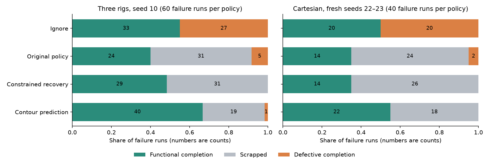

# Predicting functional failure with separate wall contours

Date: 2026-11-02. This follows the
[constrained recovery trial](notebook-recovery-trial.md). The previous `guarded`
policy avoided margin-only interventions but still lost functional prints when
its boundary-displacement forecast predicted gaps or thin walls that did not
occur on the corresponding untouched trajectory.

## Change

The new opt-in `contour` policy keeps the guarded decision sequence, action
budget, correction-rate assumption, executable-plan checks and functional
acceptance criteria. Only the observation/prediction model changes.

The old residual fit matched every source boundary point to the nearest measured
boundary, regardless of whether it was the outside of a wall or the inside of a
hole. A displacement comparable to wall thickness can therefore associate a
point with the opposite side of the wall. The resulting extrapolation can fold
or open a contour, and compensation can act on that incorrect forecast.

`ContourObservationState` changes the fit as follows:

1. Match exterior boundaries to exteriors and hole boundaries to holes, with
   one-to-one ring associations based on their geometry after translation.
2. Compute nearest positions on continuous measured contours. Smooth the local
   offsets using a 1 mm spatial scale, keeping exterior and interior samples
   separate during prediction and inverse compensation.
3. Preserve the measured printed prefix. If an observation has missing or extra
   boundaries, use the existing residual fit for the incompatible boundary role;
   do not invent a replacement measured hole or close an observed gap.

The four-observation history, short trend extrapolation, original perception,
failure injection, geometry checks and printer behavior are unchanged. This is
an analytical estimator, not a trained classifier or a calibrated probability
model. Separating contours does not guarantee a valid or accurate forecast; all
candidates still pass through the original function checks.

## Same-frame diagnosis

Eight untouched Cartesian trajectories were captured at development seed 10:
cup/mug crossed with warp, collapse, shift and under-extrusion. Each predictor
receives identical commanded geometry and camera measurements. Actual deposited
geometry is used only to score predictions and establish the final functional
outcome; it is never supplied to the predictor.

One-step forecasts are scored before incorporating the current measurement.
Full-continuation checks use the measured prefix available at that point and a
forecast for every remaining nominal command. Checkpoints include each of the
first eight affected frames and then every eighth frame, giving fourteen per
trajectory. Including the dense onset window matters for short starvation faults.

| Untouched trajectory | Actual final result | Old forecast fails / 14 | New forecast fails / 14 | Old / new one-step boundary error (mm) |
|---|---|---:|---:|---:|
| Cup collapse | Pass | 6 | 0 | 1.116 / 0.313 |
| Cup shift | Pass | 0 | 0 | 0.386 / 0.364 |
| Cup warp | Pass | 6 | 0 | 0.428 / 0.303 |
| Mug collapse | Pass | 4 | 0 | 0.383 / 0.320 |
| Mug warp | Pass | 3 | 0 | 0.345 / 0.315 |
| Cup under-extrusion | Fail | 14 | 14 | 0.356 / 0.331 |
| Mug shift | Fail | 13 | 13 | 0.409 / 0.382 |
| Mug under-extrusion | Fail | 5 | 4 | 0.358 / 0.328 |

False failure forecasts on the five functional trajectories fall from **19/70
checkpoints to 0/70**. On the three genuinely defective trajectories, missed
final-failure predictions increase from **10/42 to 11/42** checkpoints. The
starvation and shift failures are still detected during their trajectories, but
this is not a perfect classifier. These are selected development trajectories
and correlated checkpoints, not independent samples or probability calibration.

In the 24-run development comparison, `contour` finishes all eight cases within
spec, versus four for `guarded` and five for ignoring failures. The four warped
or collapsed containers now finish with zero adaptations. The three genuine
rescues—cup/mug starvation and mug shift—are retained. A separate three-run
seed-0 cup starvation check also retains its rescue. Development runs are kept
separate from the final benchmark below.

## Frozen evaluation

- Main: three profiles, four parts, five failures plus clean controls, seed 10,
  and four methods (`ignore`, `ours`, `guarded`, `contour`): **288 runs**.
- Fresh seeds: Cartesian profile, the same four parts and six conditions,
  previously unused seeds 22 and 23, four methods: **192 runs**.
- Selected seed-0 cup under-extrusion confirmation, all four methods: **4 runs**,
  excluded from benchmark totals.

The 480 benchmark runs contain 100 paired failure scenarios and 20 paired clean
scenarios. Main-study profiles share the same fault draws, so the 60 main failure
scenarios are not 60 independent draws. All monitored prints begin at zero and
image every printed layer. Faults remain active after adaptation. Final success
uses deposited geometry and the original specifications; scrap or a hypothetical
restart is never counted as a successful recovery.

Source was frozen before these evaluations and was not tuned using the two fresh
seeds. Production/spec SHA-256:
`46f242da2c1ab8ce82a293ecb0d60040c2993eb84a362585260b7bdf84f14800`.

**53 tests passed, 1 optional neural module skipped**, using
`OPENBLAS_NUM_THREADS=1 OMP_NUM_THREADS=1 MUJOCO_GL=egl .venv/bin/python -m pytest -q`.
New behavioral tests cover translation and inverse compensation, smooth wall
motion without cross-wall matching, real thickness loss, and the impossibility
of forecasting away an already-observed open wall. Existing budget, printer
bounds, functional-spec, cache, controller and forecast-ordering tests also pass.

## Results

### Main: 60 paired failure scenarios

| Policy | Functional completion | Scrap | Defective completion | Rescued vs ignore | Lost vs ignore |
|---|---:|---:|---:|---:|---:|
| Ignore | 33 | 0 | 27 | — | — |
| Original (`ours`) | 24 | 31 | 5 | 0 | 9 |
| Guarded | 29 | 31 | 0 | 8 | 12 |
| Contour | **40** | **19** | **1** | **7** | **0** |

Contour restores all twelve warped/collapsed cup and mug successes across the
three profiles, and loses one guarded-policy rescue: seed-10 moving-bed mug
shift. The net gain over guarded is **11 successful prints**. It preserves every
success from ignoring failures and genuinely rescues seven otherwise-defective
prints. Total adaptations fall from 37 to 17.

The moving-bed mug regression is real and is kept in the comparison: guarded
succeeds with adaptations at layers 108 and 113; contour adapts at 108 and scraps
at 111. Its candidate logs report one leaking layer for every available future
plan. These logs establish what the estimator believed; they do not establish
whether the stopped print's actual layer was open. No threshold was changed to
turn this or the defective spacer into a success.

### Fresh seeds and audit

| Policy | Functional completion / 40 | Scrap | Defective completion | Rescued vs ignore | Lost vs ignore |
|---|---:|---:|---:|---:|---:|
| Ignore | 20 | 0 | 20 | — | — |
| Original (`ours`) | 14 | 24 | 2 | 0 | 6 |
| Guarded | 14 | 26 | 0 | 2 | 8 |
| Contour | **22** | **18** | **0** | **2** | **0** |

The improvement holds on both fresh seeds: seed 22 improves from 6/20 guarded
successes to 10/20, and seed 23 improves from 8/20 to 12/20. All eight gains are
warped/collapsed cups or mugs. No guarded success is lost on these seeds, and
the two genuine starvation rescues at seed 23 are preserved.

Across the **100 paired failure scenarios**, contour finishes **62**, guarded
finishes **43**, the original policy finishes **38**, and ignoring failures
finishes **53**. Contour gains twenty cases over guarded and loses one. Against
ignoring failures, it preserves all 53 successes and rescues nine additional
prints. It has one defective completion versus guarded's zero. These totals use
fresh seeds 22 and 23; the previous trial used seed 21, so comparisons use the
rerun baselines in this study.



The separate seed-0 cup starvation confirmation still succeeds under guarded
and contour, while ignore and the original policy finish defective. It is
excluded from the 100-case benchmark totals.

All **80 clean runs pass**, with **zero alarms in 6,000 monitored clean frames**.
There are no pre-onset alarms in the benchmark failure runs either. The final
audit covers **484 runs**: 288 main, 192 fresh-seed and four selected-rescue runs.
All expected cases are present exactly once per experiment, source hashes remain
unchanged, outcomes are mutually exclusive, every monitored layer is imaged,
and injected faults are never cleared by adaptation. All **216 overlapping
baseline replays** match the prior study's outcomes, stopping layers, adaptation
counts and injected failure parameters. The 27 development runs and eight
untouched diagnostic trajectories are separate from this final audit.

Reviewable evidence: [audit and raw hashes](validation/contour/audit.json),
[outcome counts](validation/contour/outcomes.csv),
[per-run records](validation/contour/runs.csv),
[main paired cases](validation/contour/contour-main-v1-paired.json),
[fresh-seed paired cases](validation/contour/contour-heldout-v1-paired.json),
[changed-case decision traces](validation/contour/changed-cases.jsonl), and
[same-frame forecasts with source/input hashes](validation/contour/forecast-diagnostics.json).

This is a substantial improvement in functional completion in the tested
conditions. The moving-bed mug regression and tight-hole miss remain reasons
to retain the old policy for comparison and keep contour opt-in.

## Persistent execution

The existing evaluation processes were already running under the background
Codex service without an SSH terminal. They were preserved when the user asked
for tmux. Session `failure-recovery` provides a progress window and a second
window that waits for completion, then audits results and generates the chart.
Both windows remain available after completion:

```bash
tmux attach -t failure-recovery
```

Detach with Ctrl-b, then d. Progress and audit logs, runner scripts and exit
status files are under `/mnt/data/ishaan/hri-workspace/failure-detection/` with
the `contour-` prefix. Repository instructions now require subsequent long
training/evaluation jobs to start inside tmux and recommend the same for
interactive agent sessions.

## Limits

Camera segmentation still limits how well the measured prefix captures wall
thickness and openings. The predictor still extrapolates a short history and
has no calibrated success probability. Ring association can be ambiguous with
nearby or changing components; missing boundaries use the previous fit rather
than a new model of material loss. The study tests the combined contour fit, not
separate ablations of association, continuous correspondences and smoothing.

One concrete miss is the seed-10 Cartesian spacer shift: the new policy finishes
after two adaptations, but the actual through-hole diameter is 8.4 mm against an
8.5 mm minimum. The guarded baseline scraps this case. At the last frame, the
measured-prefix check still passes with only 0.013 normalized margin. The current
uncertainty envelope perturbs future layers, not the already-measured prefix;
at completion there are no future layers to perturb. This is evidence for
evaluating measurement uncertainty on tight tolerances, not for relaxing the
acceptance threshold. The defective finish remains a failure in every table.

MuJoCo supplies motion and rendering with prescribed geometric failures. These
outcomes do not validate melt flow, adhesion, thermal deformation, loads or real
printer recovery. `contour` remains experimental and opt-in; `ours` remains the
default.

## Reproduction

```bash
OPENBLAS_NUM_THREADS=1 OMP_NUM_THREADS=1 MUJOCO_GL=egl \
  .venv/bin/python -m recovery.cli mujoco-eval \
  --methods ignore ours guarded contour --n 1 --seed 10 --workers 8 \
  --out results/contour-main-v1

OPENBLAS_NUM_THREADS=1 OMP_NUM_THREADS=1 MUJOCO_GL=egl \
  .venv/bin/python -m recovery.cli mujoco-eval --profiles cartesian \
  --methods ignore ours guarded contour --n 2 --seed 22 --workers 8 \
  --out results/contour-heldout-v1

OPENBLAS_NUM_THREADS=1 OMP_NUM_THREADS=1 MUJOCO_GL=egl \
  .venv/bin/python -m recovery.cli mujoco-eval --profiles cartesian \
  --parts cup --kinds under_extrusion --methods ignore ours guarded contour \
  --n 1 --seed 0 --workers 1 --out results/contour-rescue-v1

.venv/bin/python tools/audit_functional_experiment.py \
  results/contour-main-v1 results/contour-heldout-v1 results/contour-rescue-v1 \
  --out docs/validation/contour --baseline results/guarded-main-v1

.venv/bin/python tools/plot_functional_trial.py docs/validation/contour \
  --experiments contour-main-v1 contour-heldout-v1 \
  --titles 'Three rigs, seed 10' 'Cartesian, fresh seeds 22–23' \
  --methods ignore ours guarded contour

OPENBLAS_NUM_THREADS=1 OMP_NUM_THREADS=1 MUJOCO_GL=egl \
  .venv/bin/python tools/capture_forecast_diagnostics.py \
  --out results/contour-diagnostics-v1

OPENBLAS_NUM_THREADS=1 OMP_NUM_THREADS=1 \
  .venv/bin/python tools/score_forecast_diagnostics.py \
  results/contour-diagnostics-v1 \
  --out docs/validation/contour/forecast-diagnostics.json
```

Use fresh output directories. Omit `--baseline` if the previous study's raw
directory is unavailable. On this machine, raw outputs are under
`/mnt/data/ishaan/hri-workspace/failure-detection/`. Earlier evidence and reports
are retained under their original names.
