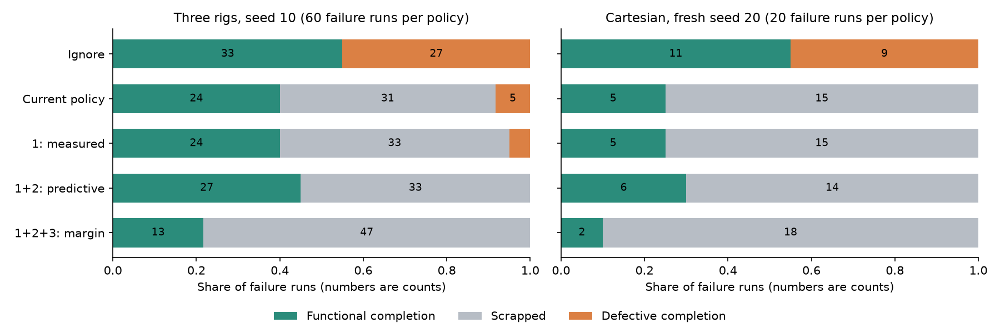

# Measured-state and predictive recovery trial

Date: 2026-10-30. Requested scope: try changes 1–3 and measure whether they
preserve a useful finished part when something goes wrong.

## Implementation

The original `ours` policy remains selectable and remains the default. The three
experimental methods are cumulative:

1. **`measured`: measured state and functional alarms.** Retain every camera
   contour, including observations below the classical 1 mm alarm threshold.
   Simplify contours at 1/16 mm without closing holes or gaps. Check wall
   thickness, container closure, hole fit, connectivity, feature presence and
   support against the part's functional requirements. Wall and hole warnings
   include a small reserve above the hard failure boundary.
2. **`predictive`: persistent-error prediction and inverse compensation.** Fit
   translation plus local boundary displacement from commanded versus observed
   geometry. Retain four recent residual fields; extrapolate their median trend
   for at most three layers, then hold it persistent. A candidate's desired
   physical shape and executable commands are separate: invert the learned
   error to generate commands, then predict their deposited geometry. Evaluate
   that geometry plus the immutable measured prefix. Optional FEA uses this
   predicted deposit too.
3. **`functional`: rank by function margin.** Rank passing candidates by the
   minimum normalized slack in support, volume, capacity, hole fit, feature
   presence and wall reserve. Evaluate thinner/thicker geometric envelopes
   using a camera-resolution/innovation uncertainty estimate. Prefer the
   greatest worst-envelope margin, then point-estimate margin; CAD fidelity is
   only a final tie breaker. Keep a passing continuation when score differences
   are within 0.02 to reduce changes driven by numerical noise.

The uncertainty estimate is a heuristic, not a calibrated probability of
success. The two morphology envelopes do not cover every possible displacement,
fault evolution or perception error. A candidate that passes the central
forecast can still be selected when an envelope fails; it is not certified safe.
Topology has hard pass/fail checks, not a continuous structural safety margin.

The existing five blend lengths (including permanent deformation) and hole
relief remain the shape choices. Inverse compensation adds a way to command
these targets under a continuing error. No simulator fault parameters, true
contours, fault onset indices or future observations enter the policy.

The original functional acceptance rules, injected failures, deposition model,
camera pipeline and three-adaptation limit are unchanged. There are no new
repair primitives or restart-success credits. The only addition to the
functional verdict's metrics is hole-center offset, used for ranking.

## Experiment design

The final code is frozen across three separate evaluations:

- Main comparison: seed 10, four parts, five failure kinds plus clean controls,
  three printer profiles, five methods: **360 runs**.
- Fresh-seed check: seed 20, the same parts/conditions/methods, Cartesian profile:
  **120 runs**. This seed was not used to develop or tune the policy.
- Selected development-case confirmation: Cartesian cup under-extrusion, seed
  0, all five methods: **5 runs**, reported separately from the benchmark.

Every monitored run starts at layer zero and images every printed layer. The
failure continues after adaptation according to its original dynamics. The
final success verdict uses deposited geometry and the original part spec.
These are geometric function tests; the benchmark does not include load-case
FEA or physical-printer validation. Camera calibration and current-layer
illumination are controlled, as in the original study.

The earlier 30-run development batch is retained at `function-dev-v1` for
provenance. It preceded the final tie tolerance and uncertainty-envelope change
and is excluded from the final results.

The three main profiles repeat the same 20 failure configurations; they are not
60 independent fault draws. Counts describe this small simulation experiment,
not an estimated real-printer success probability.

## Results

**Changes 1+2 show a modest improvement over the current policy; adding change 3
substantially worsens functional completion. None is ready to replace the
default.** Across the two benchmark sets, the current policy completes 29/80
failure scenarios in place, measured state also completes 29/80, prediction
completes 33/80, and margin ranking completes 15/80. Ignoring completes 44/80
but finishes the other 36 as defective parts. The selected development case is
excluded from these totals.



Main comparison, seed 10, 60 failure scenarios per method:

| Method | Functional in place | Scrapped | Finished defective | Rescued harmful failures / 27 | Lost otherwise-successful prints / 33 |
|---|---:|---:|---:|---:|---:|
| Ignore | 33 | 0 | 27 | — | — |
| Current (`ours`) | 24 | 31 | 5 | 0 | 9 |
| 1: measured | 24 | 33 | 3 | 0 | 9 |
| 1+2: predictive | 27 | 33 | 0 | 6 | 12 |
| 1+2+3: functional margin | 13 | 47 | 0 | 4 | 24 |

Fresh-seed check, seed 20, 20 failure scenarios per method:

| Method | Functional in place | Scrapped | Finished defective | Rescued harmful failures / 9 | Lost otherwise-successful prints / 11 |
|---|---:|---:|---:|---:|---:|
| Ignore | 11 | 0 | 9 | — | — |
| Current (`ours`) | 5 | 15 | 0 | 0 | 6 |
| 1: measured | 5 | 15 | 0 | 0 | 6 |
| 1+2: predictive | 6 | 14 | 0 | 0 | 5 |
| 1+2+3: functional margin | 2 | 18 | 0 | 0 | 9 |

"Rescued" means the same scenario fails when ignored but completes functionally
under the treatment. "Lost" means the reverse. A stopped print is not counted
as a successful recovery. All **80 clean runs** across the two sets finish
functionally, with **zero alarms in 6,400 monitored clean frames**. No method
raises a pre-failure alarm in either benchmark.

The six main-study predictive rescues are mug under-extrusion on all three rigs,
mug shifts on Cartesian and bedslinger, and cup under-extrusion on CoreXY.
Against the original policy, prediction gains nine successful
outcomes but loses six in the main set: its net gain is three, not nine. It gains
one and loses none in the fresh-seed set, but rescues none of that set's nine
failures that defeat ignore. Across both sets, adding margin ranking loses 18
outcomes relative to prediction and gains none.

Measured state catches the previously missed under-extrusion from its first
affected frame, but detecting a problem does not itself repair it. Prediction
adds an actionable compensation, with some genuine rescues and some regressions.
Margin ranking repeatedly intervenes on already feasible continuations; 22 of
its 65 scraps across the two sets are triggered by the unchanged three-replan
cap, versus zero cap-triggered scraps for the predictive variant. Its additional
scraps are not evidence of improved recovery.

The selected seed-0 cup case verifies the intended mechanism with the final
code: ignore and the original policy finish with four layers below the 1.4 mm
wall requirement. The original detector never alarms. Measured-state tracking
raises `functional_risk` at layer 116 (the first affected layer), but continues
and still fails. Prediction and the full policy both issue one inverse-compensated
nominal plan at layer 116 and finish within spec. This is a development-case
confirmation, not an additional randomly selected benchmark success.

An observed ranking regression is the Cartesian bracket warp, seed 10. Ignore,
the original policy, measured state, and prediction all finish within spec.
Margin ranking adapts at layers 26, 27 and 28, requests a fourth change at layer
29, and the unchanged controller scraps it. At that last decision, continuation
still passes the predicted geometry check. Removing the cap alone is not proven
to rescue this trajectory; the trial establishes an interaction between ranking
and the existing controller limit.

## Decision

Keep all three changes available as explicit experiments and retain the current
default. Changes 1+2 are the stronger direction, but their modest gain over the
current policy and loss of otherwise-successful prints still require work.
The next useful test is budget-aware selection that accounts for the remaining
replans, together with checking predicted margin against realized geometry.
Do not promote the current margin score as a reliable estimate of recovery
success. No success criteria were relaxed to produce these results.

## Reproduction and evidence

```bash
OPENBLAS_NUM_THREADS=1 OMP_NUM_THREADS=1 MUJOCO_GL=egl \
  .venv/bin/python -m recovery.cli mujoco-eval \
  --methods ignore ours measured predictive functional \
  --n 1 --seed 10 --workers 8 --out results/function-main-v1

OPENBLAS_NUM_THREADS=1 OMP_NUM_THREADS=1 MUJOCO_GL=egl \
  .venv/bin/python -m recovery.cli mujoco-eval --profiles cartesian \
  --methods ignore ours measured predictive functional \
  --n 1 --seed 20 --workers 4 --out results/function-heldout-v1

OPENBLAS_NUM_THREADS=1 OMP_NUM_THREADS=1 MUJOCO_GL=egl \
  .venv/bin/python -m recovery.cli mujoco-eval --profiles cartesian \
  --parts cup --kinds under_extrusion \
  --methods ignore ours measured predictive functional \
  --n 1 --seed 0 --workers 1 --out results/function-target-v1

.venv/bin/python tools/audit_functional_experiment.py \
  results/function-main-v1 results/function-heldout-v1 results/function-target-v1 \
  --out docs/validation/functional

.venv/bin/python tools/plot_functional_trial.py docs/validation/functional
```

Use fresh output directories. On this machine the raw outputs are under
`/mnt/data/ishaan/hri-workspace/failure-detection/`, rather than the repository.
The optional audit argument `--baseline .../persistent-v3` additionally verifies
that overlapping original-policy outcomes reproduce the previous study.

The audit requires a complete scenario grid, no errors, unchanged source hashes
throughout each experiment, mutually exclusive outcomes, one frame per printed
layer for monitored policies, and no more than three adaptations. It exports
compact rows, paired outcome changes, candidate traces for changed cases, source
manifests and raw-data hashes under `docs/validation/functional/`.
All **485 final runs** completed without errors, and **144 overlapping baseline
replays** match the earlier study on outcomes, printed layers, adaptation counts
and failure parameters. See [audited counts](validation/functional/outcomes.csv),
[compact run records](validation/functional/runs.csv), and
[audit and raw-data hashes](validation/functional/audit.json).

Frozen production/spec source SHA-256:
`f0b319f6073b6562feafe061f26b8fb90030da183605d32e91a3e374517d4e70`.

Validation: **36 tests passed, 1 optional neural module skipped** using
`OPENBLAS_NUM_THREADS=1 OMP_NUM_THREADS=1 MUJOCO_GL=egl .venv/bin/python -m pytest -q`.
New checks cover subthreshold state retention, thin walls and blocked holes,
persistent translation and inverse compensation, function-over-fidelity
selection, immutable broken prefixes, and FEA of predicted deposits.
