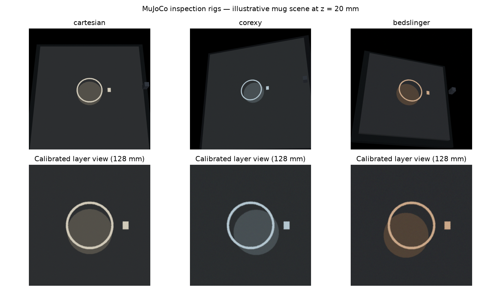
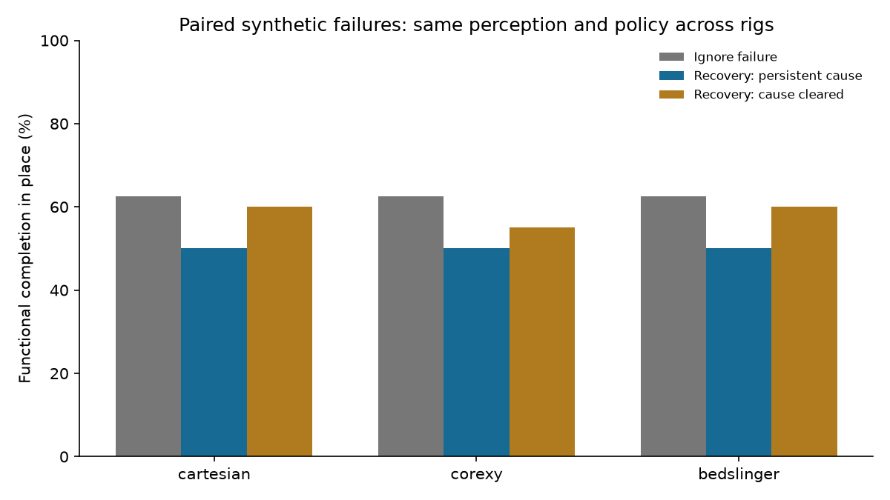

# Repository review and multi-printer recovery experiment

> **Overhead research rig.** These results use the MuJoCo printers' top-down camera
> (`recovery/printer/mujoco.py`, `recovery/camera.py`), which the real P1S does not have. The code is kept
> for these results and their tests; the real printer uses the P1S camera's own view (`recovery/p1s_view.py`).

Date: 2026-10-29. Source branch reviewed: `slop-v1`, initially `882d6fa`.
The repository and remote initially had no `main` branch. Work was isolated on
`work/mujoco-generalization`; integration status and final results are recorded below.

The [2026-10-30 follow-up trial](functional-policy-trial.md) tests measured-state
tracking, persistent-error prediction, and functional-margin ranking. This report
and its original evidence remain the baseline study.

**Finding:** the software pipeline runs across all three rigs, but reliable
end-to-end recovery has not been established. Across the paired persistent-failure
cases, recovery completed 50% functionally in place versus 62.5% for ignoring the
failure. It stopped many defective prints, but recovered none of the failures that
actually defeated the ignore baseline. The useful deliverables are the executable
multi-printer environment, corrected code, regression coverage, and an auditable
experiment that exposes the remaining method weaknesses.

## Question and scope

Can the existing detect → measure → assess → decide → adapt loop run unchanged
across different printer mechanics and camera views, and does it preserve function
when the failure cause persists? The study tests software transfer and prescribed
geometric failures. It cannot establish transfer to real machines, unseen materials,
or uncontrolled camera conditions.

## Method

`recovery/printer/mujoco.py` provides a backend with the same controller interface
as the existing simulator. MuJoCo 3.2.7 advances position-actuated stages and renders
perspective RGB frames. The shared slicer produces perimeter and solid-hatch paths;
every waypoint is sent to the simulated stages. Deposited material is reconstructed
from the realized nozzle position relative to the bed. Replacements generate G-code
with the selected bed origin and line width, then execute the common toolpath
generator. A printer firmware interpreter is not simulated.

| Profile | Motion model | Bed (mm) | Line width (mm) | Moving mass (kg) |
|---|---|---|---|---|
| Cartesian | Independent X/Y/Z head stages | 220 × 220 | 0.42 | 0.25 |
| CoreXY | Ideal diagonal motor-to-XY coordinates | 256 × 256 | 0.45 | 0.16 |
| Bedslinger | X/Z head stages, translating Y bed | 180 × 180 | 0.48 | 0.45 |

Camera position, filament color, and image noise also differ by profile. Camera
extrinsics/intrinsics are known exactly and rectify the current-height plane to
the existing 128 mm, 4 px/mm inspection view. The classical segmenter and 1 mm
deviation detector are unchanged across profiles. Ground-truth regions are used
only to score results; they are not substituted for measured contours.



The image is an illustrative mug scene at 20 mm, not an experimental recovery
outcome. `tools/render_printer_comparison.py` reproduces it.

The benchmark pairs the same failures and seeds across all methods and rigs:

- Four parts: bracket, cup, mug, spacer.
- Five failures: collapse, warp, shift, under-extrusion, detach; plus clean controls.
- Two fresh seeds, 10 and 11, after implementation checks using seed 0.
- Four policies: ignore, scrap on alarm, alert with continue/scrap, functional recovery.
- All monitored prints start at layer zero and image every completed layer.
- Main experiment: adaptation does not clear the prescribed failure.
- Matched ablation: recovery alone, with the old optimistic clear-on-adapt assumption.

This is 576 main runs and 120 ablation runs. There is no model training or
printer-specific threshold tuning in this experiment. These are configured rigs
in a small paired study, not an independent real-world generalization benchmark.

Six additional control runs reproduced the original repository's mug-collapse
regression (seed 3) on all three rigs, comparing ignore and optimistic recovery.
Both methods finished functionally on all three; recovery performed one adaptation
each. This verifies the adaptation path but supplies no counterfactual recovery
benefit. These selected controls are kept separate from the random benchmark in
`validation/legacy-recovery-control.json`.

The evaluator records functional completion in place, scraps, defective completions,
adaptations, alarm timing, pre-failure alarms, contour IoU, stage tracking error,
waypoint and frame counts, violations, and wall-clock runtime. Filament is a deposited
volume proxy. A hypothetical clean restart is reported as an additional cost;
it is never counted as observed successful recovery. Runtime is not print time.

## Results

Both experiment manifests completed without scenario errors. The audit verified
exact condition coverage, unique rows, matched failure parameters, unchanged source
hashes, imaging of every monitored layer, and no successful result assigned to an
incomplete print. The main benchmark executed **54,950,097 motion waypoints** and
processed **33,742 camera frames**. These are actual backend execution counts.

All **96 clean-control runs** completed functionally; the 72 monitored clean runs
produced **7,200 frames and zero alarms**. This result is limited to the controlled
rendering conditions described below.

Persistent failures, pooled over three rigs (120 cases per method):

| Policy | Functional in place | Scrapped | Finished defective |
|---|---:|---:|---:|
| Ignore | 75/120 (62.5%) | 0/120 | 45/120 (37.5%) |
| Scrap on alarm | 40/120 (33.3%) | 75/120 (62.5%) | 5/120 (4.2%) |
| Alert: continue/scrap | 57/120 (47.5%) | 58/120 (48.3%) | 5/120 (4.2%) |
| Functional recovery | 60/120 (50.0%) | 55/120 (45.8%) | 5/120 (4.2%) |

Recovery completed **20/40 on each rig**. Its improvement over alert was three fewer
unnecessary scraps, not rescue of a harmful failure. Each rig had 15 cases where
ignore failed; persistent recovery rescued **0/15** on each. The same underlying
part/failure/seed combinations recur across rigs, so those are not 45 independent
failure draws.

| Rig | Ignore, in place | Persistent recovery, in place | Cause-cleared recovery, in place | Harmful cases rescued after clearing cause |
|---|---:|---:|---:|---:|
| Cartesian | 25/40 | 20/40 | 24/40 | 1/15 |
| CoreXY | 25/40 | 20/40 | 22/40 | 1/15 |
| Bedslinger | 25/40 | 20/40 | 24/40 | 1/15 |

The genuine optimistic rescue was the same mug-shift case, seed 10, on all three
rigs. Clearing the cause raised pooled in-place completion from 60/120 to 70/120,
but does not describe an intervention implemented on real hardware. In-place
completion includes failures that were benign under the function spec, so it must
not be confused with the harmful-case rescue rate.



Under a hypothetical perfect clean restart, mean filament cost was 1.242 times a
clean print for recovery, 1.263 for alert, and 1.363 for scrap-on-alarm. These are
surrogate volume/cost calculations, not measured filament or successful physical
restarts. The low ignore cost includes defective and detached prints and is not a
cost per acceptable part.

Tables are retained in `validation/persistent-summary.csv`,
`validation/transient-summary.csv`, `validation/assumption-comparison.csv`, and
`validation/outcomes-by-kind.csv`. `validation/experiment-audit.json` records the
arguments, package versions, full source digest, coverage checks, and raw-file
hashes. The sample is only two seeds per part/failure; it does not support a broad
statistical or real-world generalization claim.

## Errors found and corrected

The original test run was **12 passed, 4 failed**. Specific corrections:

1. **Bundled parts could not load.** Cup/mug YAML put height ranges inside shape
   records, while the parser expected outer ranges. Both documented forms now work;
   conflicting ranges are rejected.
2. **Camera rasterization erased nested material.** A ring's hole could overwrite
   a separate material island. Components now rasterize separately and are combined;
   subpixel pores no longer erase whole pixels.
3. **Incomplete monitoring biased evaluation.** The old runner stopped imaging
   after 25 quiet layers. Default scenario/evaluation runs now keep monitoring.
4. **FEA candidates could bypass structural checks.** The filter stopped at its
   first passing candidate but left later candidates eligible for an LLM choice.
   Every geometry-passing candidate is now structurally checked when FEA is enabled.
5. **CLI forwarding rejected child flags.** Evaluation/training/data commands now
   delegate their arguments before the parent parser consumes them.
6. **G-code state was reconstructed incorrectly.** The final extrusion width was
   previously applied to every segment, and missing `;Z:` comments could assign the
   final Z to earlier layers. Width and height are now captured per extrusion;
   relative XY and signed fractional coordinates are supported. Unsupported inch
   mode and radius arcs fail explicitly.
7. **Live interface mismatch and ignored timeouts.** The controller expected
   `printed`, absent on the Bambu backend. It now stores measured observations.
   Pause/stop/start timeouts abort, missed layers abort, cleanup uses `finally`, and
   unacknowledged streaming is disabled. These are mocked/local checks, not hardware
   validation; a live final verdict remains an image-based estimate.
8. **SegFormer checkpoint architecture mismatch.** Reloading a pretrained variant
   rebuilt the default architecture. Training now saves its complete configuration,
   and reload/fine-tuning use it. Random initialization also respects the requested
   architecture metadata. Offline checkpoint reload and inference were tested with
   a deliberately non-default configuration.
9. **Hole diameter ignored interior exclusions.** Inscribed diameter now measures
   distance to the entire boundary rather than only the outer ring.
10. **STL optional dependencies were incomplete.** Added `networkx` and `rtree` to
    the full requirements; an actual STL box cross-section was exercised.
11. **Simulation lifecycle and accounting.** Paused/cancelled/finished simulation
    moves are rejected. Ignore-policy filament accounting uses deposited volume.
    The new benchmark separates observed success from assumed restarts.

## Numerical validation

The final core suite reports **30 passed, 1 skipped** (the optional neural module).
The two neural tests separately passed in an existing PyTorch 2.7.1 /
Transformers 4.53.2 environment, giving **32 passing regression tests across the
two environments**. Test receipts and environment details are in `validation/`.
The integrated research example below remains a reported negative result on one
rig; it is not hidden by those passing regression tests.

All four parts pass their nominal geometry specifications, coarse FEA loads and
offline heuristic spec verification. A zero-Poisson-ratio axial-bar patch test
matches displacement `F L / A E`. This checks solver assembly and force application;
it is not a material calibration or mesh-convergence study.

| Load | Safety factor, 99th-percentile stress | Max displacement (mm) |
|---|---:|---:|
| Bracket, 100 N at opposite bolt | 4.17 | 0.796 |
| Cup, water | 13,556.74 | 0.000030 |
| Mug, water | 16,733.15 | 0.000054 |
| Mug, 30 N handle pull | 17.06 | 0.083 |
| Spacer, 6 kN preload | 2.59 | 0.089 |

These are the repository's illustrative material constants at a 2 mm voxel size.
Both water cases passed the finer cavity/leak check. Full numerical records are in
`validation/structural-checks.json`. The benchmark itself uses geometry verdicts;
`tools/validate_full_pipeline.py` separately exercises authored specs, pre-print FEA,
candidate FEA, final FEA, RGB recovery, and replacement-G-code round trips.

The integrated authored-spec example is deliberately not reported as universally
successful. For a cup collapse (seed 10, optimistic transient cause), the CoreXY
rig's candidate and final FEA checks passed, but its finished geometry violated
the generated wall rule: five layers below 1.1 mm. This exposes the gap between
candidate prediction from camera contours and realized deposition, and shows why
an FEA pass cannot replace the final geometric verdict. The validation script
returns a nonzero exit status when any of its final function gates fail.

In that example, Cartesian and bedslinger finished within both the geometry and
structural specifications. Each rig imaged all 160 layers and performed one
adaptation. The policies executed 29, 23, and 23 candidate stress checks respectively.
The replacement G-code bodies, parsed with their required `M83` context, retained
the expected layer counts and minimum contour IoUs of 0.990, 0.987, and 0.980.
See `validation/full-pipeline.json` for all three outcomes, including the failure.

Inspection of a missed Cartesian cup under-extrusion (seed 10) found deviations of
only 0.50–0.66 mm over the five affected layers, so every frame was labelled `ok`.
At layer 108 the true region had an open wall but the measured contour still had
an enclosed hole; at layers 109–111 the measured topology changed but the distance
threshold still suppressed an alarm. This is both a measurement limitation and a
poor match between a universal distance threshold and a leak-sensitive function.
The observations are preserved in `validation/missed-under-extrusion.json`.

The next method changes should therefore prioritize function-sensitive/topology
alarms, uncertainty margins around measured walls, and a verified way to arrest
the underlying process failure before geometry adaptation. Those changes need new
experiments; lowering acceptance limits to make these results pass would not
establish recovery. Physical tests should then check leakage, hole fit, bond
strength, and safe resume behavior on the target printers.

## Simulation assumptions and remaining gaps

- Waypoint motion is quasi-static: 40 MuJoCo steps of 2 ms per target. Ideal CoreXY
  transforms do not model belt stretch, motor torque limits, or realistic feed-rate
  tracking. Tiny tracking errors under settled moves do not validate real hardware.
- Beads are geometric buffered paths. A 0.1 mm morphological closing represents
  fusion of adjacent beads before any failure is injected. It closes gaps up to
  roughly 0.2 mm; it is not an experimentally calibrated material model. The first
  smoke run omitted this assumption and clean prints failed because microvoids
  fragmented continuum wall checks. Those diagnostic runs are not final results.
- Failures are prescribed deformations, not emergent MuJoCo plastic mechanics.
  There is no thermal, extrusion-flow, adhesion, delamination, or collision model.
- Current-layer illumination is controlled and older visible layers are dimmed.
  Only the base and a few recent slabs are rendered. Calibration is exact. Real
  equal-color layers, occlusion, illumination shifts, and calibration error remain
  important untested perception problems.
- The existing part/function model uses uniform-height 2.5D layers and a limited
  inspection field of view. Arbitrary 3D parts, adaptive layer heights, support-rich
  G-code, and broad firmware dialects are not established by these runs.
- FEA is a linear, coarse screening model. Geometry success and nominal FEA passes
  do not prove watertightness, bond strength, or load-bearing behavior of real prints.
- Learned-model accuracy, full training/fine-tuning, live LLM calls, Gradio behavior,
  Bambu Studio automation and physical pause/upload/resume remain unvalidated.
  Heuristic specs encode guessed loads; passing them cannot establish intended use.

## Reproduction

```bash
python3 -m venv .venv
.venv/bin/pip install -r requirements-sim.txt
export MUJOCO_GL=egl OPENBLAS_NUM_THREADS=1 OMP_NUM_THREADS=1
.venv/bin/python -m pytest -q
.venv/bin/python -m recovery.cli mujoco-eval --n 2 --seed 10 --workers 6 \
  --out results/persistent
.venv/bin/python -m recovery.cli mujoco-eval --n 2 --seed 10 --workers 3 \
  --kinds collapse warp shift under_extrusion detach --methods ours \
  --clear-failure-on-adapt --out results/transient
PYTHONPATH=. .venv/bin/python tools/validate_full_pipeline.py --out results/full-pipeline
PYTHONPATH=. .venv/bin/python tools/render_printer_comparison.py
PYTHONPATH=. .venv/bin/python tools/summarize_experiment.py \
  --persistent results/persistent --transient results/transient
```

MuJoCo's Linux headless backend uses EGL; alternative renderer installation details
are in the [official MuJoCo documentation](https://mujoco.readthedocs.io/en/3.2.7/python.html).
SegFormer architecture/configuration behavior is described in the
[official Transformers documentation](https://huggingface.co/docs/transformers/model_doc/segformer).
Only the optional neural tests need Torch/Transformers. The full requirements add
STL, hardware, UI and model dependencies. The exact simulation package list is
saved in `validation/sim-environment.txt`.

Raw output directories on this machine are under
`/mnt/data/ishaan/hri-workspace/failure-detection/`: `persistent-v3`, `transient-v3`,
and `full-pipeline-v4`. Small summaries/provenance records are retained in this repo;
large environments and raw outputs stay on the data disk.

## Integration

The implementation commit is `5ecda34` on `work/mujoco-generalization`. Its source
digest matches both completed benchmarks. The report, small validation artifacts,
and summarization tool accompany it on local `main`, created from the original
`slop-v1` tip and merged at `3258b66` without rewriting that branch. The original
research features are retained with their validation limits stated above.

**Review delivery (2026-10-30):** publication was explicitly approved after the
initial local integration. The reviewed work is delivered on
`review/mujoco-generalization` for a pull request into remote `main`, initialized
at the original `slop-v1` tip (`882d6fa`). The remote merge is left for review.
The original `slop-v1` branch and GitHub's default-branch setting are unchanged.
