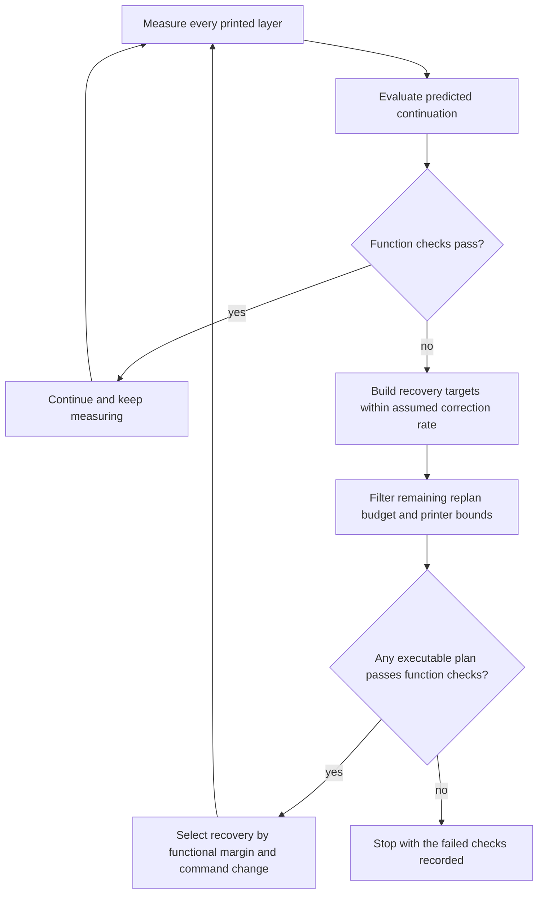
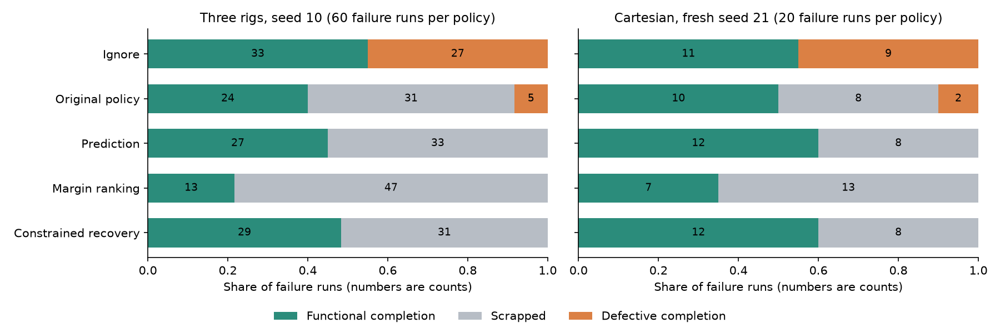

# Notebook-inspired constrained recovery

Date: 2026-11-02. Source: [HW4_Print_Recovery_Assistant.ipynb](https://colab.research.google.com/drive/1qsvnBkzzJ74yCOGFyT7BJHdNe8Nc2IIN),
modified 2026-11-01. The notebook was read through Drive; its analytical ideas
were adapted into the existing feedback loop. No Gemini calls, model training,
notebook installation commands or changes to the source notebook were needed.

## What transfers

The notebook separates functional adequacy, recovery reachability and expected
cost. That separation addresses the previous policy's tendency to intervene
whenever a different plan has a better geometric margin.

| Notebook idea | Application in this repository |
|---|---|
| Functional geometry check | Retain the existing arbitrary-contour function checks, including holes, closure, support and wall thickness. A cylinder-volume formula would be less expressive. |
| Required layers = ceil(correction / per-layer limit) | Derive a bounded shape transition from the measured displacement field and record whether a full return fits the remaining layers. |
| Expected recovery cost under an assumed success probability | Extend the comparison to **continuing versus intervening**, with a break-even improvement in success probability. Unknown probabilities stay unknown. |
| Explicit assumptions and tool results | Log correction budgets, execution feasibility, margins, material tradeoffs and remaining replans with candidate decisions. |

The notebook's return-to-reference calculation is not an instruction to restore
CAD at all costs. A permanent or partial deformation remains eligible if it
meets the original functional requirements.

## Implementation

`GuardedPolicy`, selected as `guarded`, keeps measured-state tracking and the
existing persistent-error predictor. It changes the decision sequence:



- A passing continuation wins without requesting a margin-only replan. Warnings
  still get assessed on every affected frame; a stable warning is not hidden.
- Remaining adaptations and a replacement validator are explicit decision
  inputs. Reaching the three-adaptation limit does not itself turn a passing
  continuation into a scrap. A failing continuation with no executable recovery
  still stops.
- Layer count and heights are checked before selection. The MuJoCo backend's
  validator also checks bed/FOV bounds; other backends need to expose their own
  validator to enforce those limits. An invalid candidate is recorded and
  rejected so alternatives can still be considered.
- Recovery targets include a held measured shape, a bounded return or partial
  correction, and slower blends. The default correction assumption is
  **0.25 mm/layer**, shared across profiles. It bounds the sampled fitted
  displacement field's correction schedule, not measured nozzle capability,
  local material mechanics or guaranteed realized contour motion. Actual
  predicted geometry must still pass the original function checks.
- Candidate margins rank recovery choices only after continuation fails.
  Smaller command changes break otherwise equal functional scores.
- Optional FEA checks predicted deposited geometry. A passing continuation can
  return immediately; unnecessary recovery candidates need not be stress-tested.
- The overhang cache now uses persistent identity tokens and the complete
  nominal reference in its key. This fixes the review finding about recycled
  Python object IDs and prevents cached results from crossing reference designs.
  All rerun policies receive this common correctness fix.

The old `ours`, `predictive` and `functional` policies remain available for
comparison. Their selection rules are unchanged; the original default remains
`ours`. The new policy is experimental.

## Cost without an invented success probability

Using one consistent cost unit, the extended notebook calculation is:

```
expected continue cost = C_continue + (1 - p_continue) * C_restart
expected recovery cost = C_intervention + C_recovery + (1 - p_recovery) * C_restart

recovery breaks even when:
p_recovery - p_continue > (C_intervention + C_recovery - C_continue) / C_restart
```

For example, if continuing and recovering each take two hours and have the same
80% chance of success, a 15-minute intervention adds cost. Recovery can be
cheaper than restarting while still being worse than continuing. The notebook's
original example, compared against a five-hour restart, still gives 1.75 hours
of expected savings at an assumed 80% recovery success probability.

The policy does **not** interpret a margin as a probability. Candidate logs
provide the extra success probability needed to justify added material under
the notebook's hypothetical restart assumption. Material is a volume proxy in
mm³; it is not a measured time estimate. Expected savings and the economic
recommendation remain `null` unless probabilities are supplied to the analytical
tool. These thresholds are diagnostics, not an automatic economic optimizer.
The controller's implemented intervention gate is functional feasibility.

## Validation design

The code was frozen before the main and fresh-seed evaluations:

- Main: seed 10, four parts, five failures plus clean controls, three profiles,
  five methods (`ignore`, `ours`, `predictive`, `functional`, `guarded`): 360 runs.
- Fresh-seed check: seed 21, four parts, the same six conditions and five methods,
  Cartesian profile: 120 runs. This seed was not used to develop the policy.
- Selected rescue confirmation: seed-0 Cartesian cup under-extrusion, five
  methods: 5 runs, excluded from benchmark totals.
- A separate five-run preflight replays the seed-10 Cartesian bracket-warp
  regression. The old margin policy scraps it after three adaptations; the new
  policy finishes within spec with zero adaptations.

No fault is cleared because of adaptation. All monitored prints start at zero
and image every printed layer. Final verdicts use deposited geometry and the
unchanged part specifications. The three main profiles repeat the same failure
draws, so their 60 failure scenarios are not 60 independent draws. Geometry-only
simulation results do not establish physical-printer recovery or load capacity.

The evaluator also records one-step forecast error against deposited geometry,
computed **before** incorporating the current measurement. Truth is confined to
evaluation and never supplied to the predictor or policy. The comparison with
commanded geometry uses the same observed frames. These are diagnostics of
boundary error, not calibrated probabilities of success; different policies can
stop at different times and therefore score different frame sets.

Validation: **49 tests passed, 1 optional neural module skipped** with
`OPENBLAS_NUM_THREADS=1 OMP_NUM_THREADS=1 MUJOCO_GL=egl .venv/bin/python -m pytest -q`.
Tests cover the notebook's analytical examples, invalid inputs, bounded
transitions, unknown probability handling, passing continuation at an exhausted
budget, rejection of invalid candidates, persistent warning observation, cache
correctness and forecast evaluation without using the current measurement.

Frozen production/spec source SHA-256:
`8767444770139cee94b9b2d8b150d696600cb09383f3fd406d4a54c7915614db`.

## Results

### Main study: 60 paired failure scenarios

| Policy | Functional completion | Scrap | Defective completion | Rescued vs ignore | Lost vs ignore |
|---|---:|---:|---:|---:|---:|
| Ignore | 33 | 0 | 27 | — | — |
| Original (`ours`) | 24 | 31 | 5 | 0 | 9 |
| Predictive | 27 | 33 | 0 | 6 | 12 |
| Margin ranking (`functional`) | 13 | 47 | 0 | 4 | 24 |
| Constrained recovery (`guarded`) | **29** | **31** | **0** | **8** | **12** |

The new policy gains two successes over prediction and sixteen over margin
ranking, losing none of either policy's successful cases. It still finishes
fewer prints than ignoring failures: eight genuine rescues are offset by twelve
otherwise-successful prints lost. Scrap is never counted as recovery.

The action traces explain three useful changes:

- **Unnecessary intervention:** seed-10 Cartesian bracket warp finishes with
  zero adaptations under `guarded`. Margin ranking adapts at layers 26, 27 and
  28, then the controller scraps at layer 29 even though its continuation
  candidate passes. The new policy retains passing continuation.
- **Gentler selection:** seed-10 Cartesian cup under-extrusion succeeds with one
  adaptation at layer 107. Its functional scores tie across several plans;
  minimizing command change selects the 120-layer blend. Prediction and margin
  ranking choose nominal compensation and later scrap. The correction budget
  is only one layer here, so the bounded-rate formula does not explain this
  particular gain.
- **Bounded transition:** seed-10 CoreXY mug shift succeeds with bounded-return
  plans at layers 108 and 113, requiring six and seven correction layers under
  the stated assumption. Prediction chooses nominal compensation and scraps at
  layer 114. This is a combined-policy comparison, not an ablation proving
  which individual change caused the gain.

There are no controller-forced replan-cap scraps under `guarded`, versus eighteen
under margin ranking in the main study. **Three guarded runs still stop with
their adaptation budget exhausted and a failing continuation forecast**:
Cartesian mug collapse and Cartesian/CoreXY spacer shift. The cap remains a
real constraint; it no longer overrides an already-passing continuation.

### Fresh-seed check and diagnostics

| Policy | Functional completion / 20 | Scrap | Defective completion | Rescued vs ignore | Lost vs ignore |
|---|---:|---:|---:|---:|---:|
| Ignore | 11 | 0 | 9 | — | — |
| Original (`ours`) | 10 | 8 | 2 | 0 | 1 |
| Predictive | 12 | 8 | 0 | 3 | 2 |
| Margin ranking (`functional`) | 7 | 13 | 0 | 2 | 6 |
| Constrained recovery (`guarded`) | **12** | **8** | **0** | **3** | **2** |

On fresh seed 21, `guarded` succeeds on exactly the same cases as prediction.
It gains five successes over margin ranking and loses none. Across the two
benchmark sets, the totals are **41/80 guarded, 39/80 predictive, 20/80 margin
ranking, 34/80 original and 44/80 ignore**. Guarded has eleven genuine rescues
versus ignore and fourteen losses. These totals use fresh seed 21; the previous
trial used seed 20, so compare with the rerun baselines above.



The selected seed-0 cup under-extrusion rescue is retained: predictive, margin
ranking and guarded finish within spec; ignore and the original policy finish
defective. This selected case and the duplicate bracket preflight are excluded
from the 80-case benchmark totals.

All **80 clean runs pass**, with **zero alarms in 6,400 monitored clean frames**.
There are also no pre-onset alarms in the benchmark failure runs. The final
audit covers **490 runs**: 480 benchmark runs, five selected-rescue confirmations
and five regression-preflight runs. Every expected case is present exactly once
per experiment, all runs use the same frozen source hash, no injected fault is
cleared on adaptation, and camera counts match monitored printed layers.
All **288 overlapping main-study baseline runs** reproduce the previous study's
outcomes, adaptation counts, stopping layers and injected failure parameters;
four overlapping preflight runs also match.

One-step boundary error, in mm, is averaged over the scored post-onset frames
within each policy. The commanded-geometry comparison uses those same frames:

| Study | Policy | Scored frames | Forecast error | Command-only error |
|---|---|---:|---:|---:|
| Main | Predictive | 879 | 0.965 | 2.124 |
| Main | Margin ranking | 595 | 1.256 | 1.538 |
| Main | Guarded | 985 | 0.903 | 2.108 |
| Fresh seed | Predictive | 870 | 0.579 | 1.789 |
| Fresh seed | Margin ranking | 514 | 0.732 | 0.787 |
| Fresh seed | Guarded | 865 | 0.577 | 1.778 |

The predictor contains useful information relative to assuming commanded
geometry is deposited exactly. These averages do not show that the guarded
policy has a better predictor: the predictor is unchanged, and the policies
produce different commands and stop on different frames. They also do not
measure the accuracy of multi-layer functional-failure predictions.

Reviewable evidence: [audit and raw-result hashes](validation/guarded/audit.json),
[outcome counts](validation/guarded/outcomes.csv),
[per-run records](validation/guarded/runs.csv),
[main paired cases](validation/guarded/guarded-main-v1-paired.json),
[fresh-seed paired cases](validation/guarded/guarded-heldout-v1-paired.json), and
[decision traces for changed cases](validation/guarded/changed-cases.jsonl).

### Interpretation

This is a modest improvement over prediction and a substantial repair to the
margin-ranking policy. It does not establish a good enough recovery system to
promote by default. In particular, the twelve lost main-study cases are warped
or partially collapsed cups and mugs. The short-history model extrapolates
boundary displacement and predicts openings or thin walls; intervention can
then change an otherwise-functional trajectory. Final geometry confirms that
the corresponding ignored prints meet the original spec.

The next useful model evaluation should measure **false predictions of
functional failure**, including hole closure and minimum wall thickness, on
untouched continuation trajectories and separate seeds. Lower boundary error
alone does not establish a better intervention decision. Calibrating success
probabilities for both continuation and recovery would make the notebook's
economic rule actionable. The current study does not provide that calibration,
and its 0.25 mm/layer correction assumption still needs physical measurement.

## Reproduction

```bash
OPENBLAS_NUM_THREADS=1 OMP_NUM_THREADS=1 MUJOCO_GL=egl \
  .venv/bin/python -m recovery.cli mujoco-eval \
  --methods ignore ours predictive functional guarded \
  --n 1 --seed 10 --workers 8 --out results/guarded-main-v1

OPENBLAS_NUM_THREADS=1 OMP_NUM_THREADS=1 MUJOCO_GL=egl \
  .venv/bin/python -m recovery.cli mujoco-eval --profiles cartesian \
  --methods ignore ours predictive functional guarded \
  --n 1 --seed 21 --workers 4 --out results/guarded-heldout-v1

OPENBLAS_NUM_THREADS=1 OMP_NUM_THREADS=1 MUJOCO_GL=egl \
  .venv/bin/python -m recovery.cli mujoco-eval --profiles cartesian \
  --parts cup --kinds under_extrusion \
  --methods ignore ours predictive functional guarded \
  --n 1 --seed 0 --workers 1 --out results/guarded-rescue-v1

OPENBLAS_NUM_THREADS=1 OMP_NUM_THREADS=1 MUJOCO_GL=egl \
  .venv/bin/python -m recovery.cli mujoco-eval --profiles cartesian \
  --parts bracket --kinds warp \
  --methods ignore ours predictive functional guarded \
  --n 1 --seed 10 --workers 1 --out results/guarded-regression-v1

.venv/bin/python tools/audit_functional_experiment.py \
  results/guarded-main-v1 results/guarded-heldout-v1 results/guarded-rescue-v1 \
  results/guarded-regression-v1 \
  --out docs/validation/guarded

.venv/bin/python tools/plot_functional_trial.py docs/validation/guarded \
  --experiments guarded-main-v1 guarded-heldout-v1 \
  --titles 'Three rigs, seed 10' 'Cartesian, fresh seed 21' \
  --methods ignore ours predictive functional guarded
```

Use fresh output directories. Raw runs on this machine are under
`/mnt/data/ishaan/hri-workspace/failure-detection/`. The prior study's raw runs
and committed evidence are retained. Its source hashes refer to its original
implementation and should be audited from that version. To verify the historical
replays as well, append `--baseline results/function-main-v1` to the audit command
when that prior study's raw directory is available.
