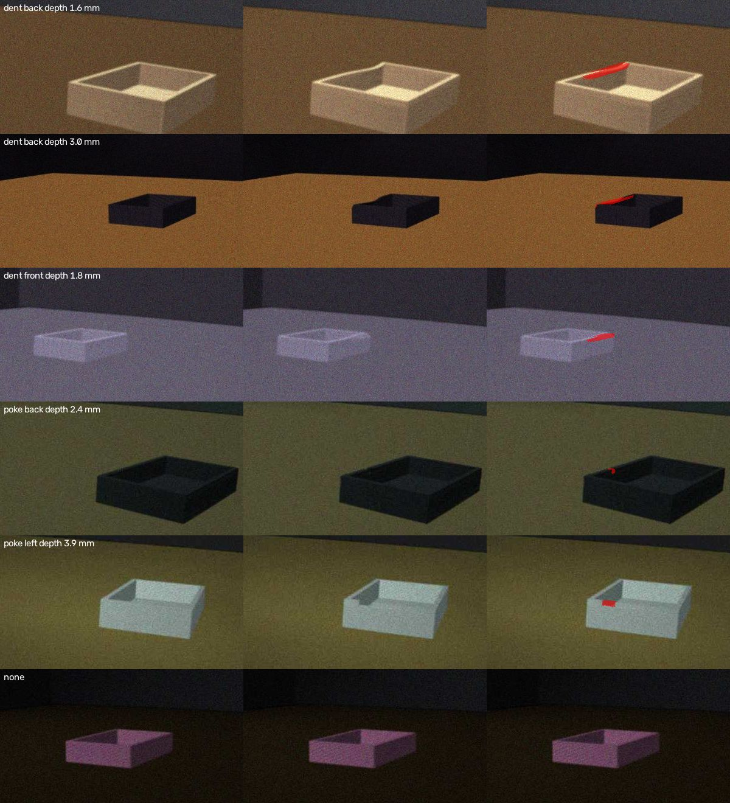

# Synthetic P1S camera pairs for dent / poke detection

The MuJoCo rig in `recovery/printer/mujoco.py` looks straight down. The real P1S chamber camera does not: it
sits low at the front-left of the chamber and looks almost horizontally across the plate through a fisheye
lens. `recovery/p1s_view.py` renders that view, and `recovery/p1s_dent_data.py` uses it to make
before/after training pairs of the container dent test (`parts/print/water-tray/README.md`). Real
dent-test photos are the test set.

```bash
pip install -r requirements-sim.txt
python -m recovery.p1s_dent_data --n 3000 --out data/p1s_dent --workers 12          # ~5 min on 12 workers + GPU
python -m recovery.p1s_dent_data --n 3000 --out data/p1s_dent --calib calib.npz      # with a real calibration
python -m recovery.p1s_dent_data --n 3000 --out data/p1s_dent --part-xy 128,128      # part where it is really printed
```



## What one pair is
1. The water tray is printed up to about half height: the pause layer is 30 (z = 6 mm), ±3 layers.
2. **Before** frame: the camera's view at the pause.
3. The warm top layers are changed the way a person does it during the pause, with the same functions the agent
   rehearses with (`recovery/agent/rehearse.py`):
   - `dent`: `dent_layers`, a gentle push that bends the wall in. Depth 0.4 to 3 mm, width 2.5 to 6 mm,
     full depth on the top layer and tapering to zero 3 to 8 layers down;
   - `poke`: `poke_layers`, a tool pushed through the wall. Hole 1 to 3 mm, reach 1.6 to 4 mm, top 2 to 5 layers;
   - `none`: nothing changes. This is the negative class, and the frames still differ by sensor noise and a ±4 %
     exposure change.
4. **After** frame: same camera, lights and bed position, with fresh noise.

Default class mix is 40 / 30 / 30 (`--weights`). The wall is front / back / left / right of the part as printed
(front = −Y, the side nearest the door, which is the README's "long front wall"). The position along the wall
is uniform over its middle 75 %.

## Camera and moving bed
- **Lens and pose**: the default camera is a fit (`recovery/calib_offline.py`, on the `calibration-changes`
  branch) to the real P1S bed-edge clicks in `tests/data/p1s_clicks_issue5.json`, using calib_z = 5 mm with the
  measured 22.784 mm camera height as a prior. 5 mm is the only calib_z at which the fitted height agrees with
  the measurement. The fit gives f = 801 px, k1 = −0.304, k2 = +0.099, and the camera at X = −32, Y = 35 mm,
  22.1 mm above the print plane, looking 9° down with a 31° heading. **The fit's edge residual is 4.5 mm RMS,
  which the calibration tool does not accept**, so treat it as approximate. Each sample jitters it (position
  σ 2 mm, rotation σ 0.8°, focal length σ 2 %, k1 σ 0.02, k2 σ 0.01). Once Akshara's checkerboard calibration
  is saved (`calibrate-board … --out calib.npz`), pass `--calib calib.npz`. The file must contain
  `calib_z_mm`. Use `--no-camera-jitter` to render it exactly.
- **Fisheye**: MuJoCo renders a wider pinhole image, which is resampled through the OpenCV k1/k2 model into the
  1280 × 720 frame. A test checks the maps against `cv2.projectPoints`, and another checks that the rendered
  tray lands where the calibration projects it.
- **Moving bed**: the P1S bed drops one layer per layer while the nozzle and camera stay put, so the top of the
  print stays at the nozzle plane (`calib_z_mm` above the calibrated plate). The plate sits lower the taller the
  print is. A random extra drop of 0 to 0.6 mm stands in for the Z-hop during the pause.

## What is randomised
Filament colour (12 common PLA colours with jitter) and gloss; plate type (textured PEI, smooth PEI, cool
plate, engineering plate); chamber colour; 1 to 3 lights (position, spot or directional, strength) plus ambient
light; the toolhead parked in view 40 % of the time, never between the camera and the part; part position
(X, Y from 40 to 140 mm, resampled until the whole part is in frame) and yaw (σ 8°, flipped 180° 15 % of the
time); layer wobble and corner rounding; layer-line relief; camera pose and lens; exposure, white balance,
gamma, vignetting, blur, read and shot noise, and JPEG quality from 35 to 92.

## Output (`--out`)
```
images/000123_before.jpg  images/000123_after.jpg   1280x720
masks/000123.png          255 where the surface moved by more than 0.05 mm (before/after depth), else 0
labels/000123.json        one label per pair (also concatenated in labels.jsonl)
manifest.json             config, base camera, git commit, counts, failed samples
preview.jpg               a few pairs: before | after | mask overlay
```
Label fields: `kind`, `wall`, `along_mm` (from the wall's centre, +X for front/back, +Y for left/right),
`depth_mm` (dent depth, or poke reach), `width_mm` / `hole_mm`, `layers`, `contact_mm` (part frame),
`contact_px` (image), `change_px`, `change_bbox` (`[x0, y0, x1, y1]`), `visible` (≥ 15 changed px),
`outer_face_toward_camera`, `cavity_open_after` (the wall is open, so it would leak; true for every poke here),
`pause_layer`, `top_z_mm`, `bed_drop_mm`, `part_xy_mm`, `part_yaw_deg`, `split` (every 10th pair is `val`),
plus the `look`, `photometric` and per-sample `camera` used.

## First run (`data/p1s_dent_v1`, not committed)
3000 pairs in 4 min (12 workers, RTX 5060 Ti), 0 failures, 437 MB: 1167 dent, 896 poke, 937 none; 2700 train,
300 val. Every dent changes at least 15 px (median 442 px; by wall: front 395, back 325, left 630, right 445).
Pokes are small: median 40 px, with 91 % above the 15 px visibility threshold. No `none` pair has a changed
pixel.

## Things to know before training
- From this camera the **front wall is seen almost edge-on** and the **left wall faces the camera**. The back
  and right walls are only seen from the inside, over the rim. A dent on the front wall therefore covers few
  pixels. `outer_face_toward_camera` and `change_px` let you stratify or filter.
- Pokes are small (median 40 changed px). A model has to work at full resolution or on a crop around the part.
- The images are clean renders. There are no cast shadows: MuJoCo's shadow maps alias on the 0.2 mm layer
  ridges, so shadows are off. There is also no stringing, no ooze from the parked nozzle, and no hand or tool in
  frame. Expect a sim-to-real gap and judge only on the real photos.
- For the real test set, label photos in the same `labels.jsonl` format (at least `kind`, `wall`, `along_mm`,
  `depth_mm`). Where the part really sits on the plate (`--part-xy`) and the final calibration (`--calib`) are
  the two settings most worth matching.

## Detector (`recovery/models/dent.py`)
Input, like the layer models in `nets.py`: before RGB + after RGB + a guide channel, 7 × 256 × 256. The guide is
the part's outline, projected from the calibration and the part's bed position (the analogue of the expected-layer
render). Frames are cropped to a square around the guide, because a downscaled full frame would lose a 40 px poke.
The model is a SegFormer (MiT-b2, ImageNet/ADE20k weights, 7-channel stem). Per pixel it predicts changed or not,
dent vs poke, and which wall. Image-level kind and wall come from the predicted change region; the smallest region
that counts as "touched" is tuned on the val split.

A whole-image ConvNeXt-V2 classifier was tried first and stayed at chance (it overfits 64 pairs, so the loop
works; it cannot find the change from one label per image). Per-pixel supervision is what makes it learn.

```bash
python -m recovery.models.dent build --data data/p1s_dent_v1 --out data/p1s_dent_v1/crops.npz
python -m recovery.models.dent train --crops data/p1s_dent_v1/crops.npz --out runs/dent --pretrained   # ~11 min
python -m recovery.models.dent eval  --crops data/p1s_dent_test_s1/crops.npz --ckpt runs/dent
```

Results, `runs/dent_v2`. **Simulation only, no real photo has been scored.** "Held-out" is a separate 600-pair set
generated with `--seed 1`; val is the 300-pair split used to pick the epoch and the threshold.

| | val (300) | held-out sim (600) |
|---|---|---|
| dent / poke / none all correct | 95.3 % | **91.0 %** |
| touched vs untouched correct | 95.7 % | 92.8 % |
| dent recall / precision | 97.6 / 97.6 % | 88.1 / 97.3 % |
| poke recall / precision | 93.2 / 96.5 % | 86.3 / 96.2 % |
| false alarm (untouched flagged) | 5.6 % | 0.5 % |
| wall correct (dent or poke) | 82.5 % | 76.8 % |
| change-mask IoU | 0.57 | 0.54 |

Held-out confusion (rows true, columns predicted; dent, poke, none): `[[214, 6, 23], [5, 151, 19], [1, 0, 181]]`.
Almost all errors are touched prints called untouched. Detection by how many pixels changed: < 15 px 54 %,
15 to 50 px 88 %, 50 to 200 px 95 %, ≥ 200 px 91 %. The model is conservative on held-out data, so a lower
threshold would trade false alarms for recall.

## In the agent's dent test (the default)
`python -m recovery.cli agent --dent-test …` now measures the change from the P1S camera's own view
(`--measure sideview`, `SideViewMeasure` in `recovery/agent/measure.py`). It compares the frames saved at the pause
before and after the change, then turns the detector's kind, wall and position into the existing
`dent X Y DEPTH` / `poke X Y` / `none` description. From there, the function check, decision and approval are
unchanged. Depth is not measured: a dent is taken as 1.5 mm, which only affects the capacity check.
- `--dent-model runs/dent` is the checkpoint. If it is missing, the agent falls back to `--measure manual` (typed in).
- `--calib calib.npz` is used if it records the bed Z (`calib_z_mm`); otherwise the approximate default camera.
- Sim rehearsals (`PlannedPauseSim`) render every frame from the P1S view (part at the plate centre), like
  the real printer: there is no top-down image.

Sim rehearsals with `runs/dent_v2` (`agent --sim --dent-test … --auto-approve --monitor off`):

| change made | camera said | agent |
|---|---|---|
| dent −15 0 2 (left wall) | dent, left wall at (−15.5, −0.8) | resume |
| dent 0 −10 1.5 (front wall) | dent, front wall at (−2.9, −10.5) | resume |
| dent 15 0 2 (right wall) | dent, right wall at (15.5, −0.7) | resume |
| poke 0 −10 (front wall) | poke, front wall at (1.0, −10.5) | stop (leaks) |
| poke −15 3 (left wall) | poke, **right** wall at (15.5, 4.4) | stop (leaks) |
| none | none | resume |
